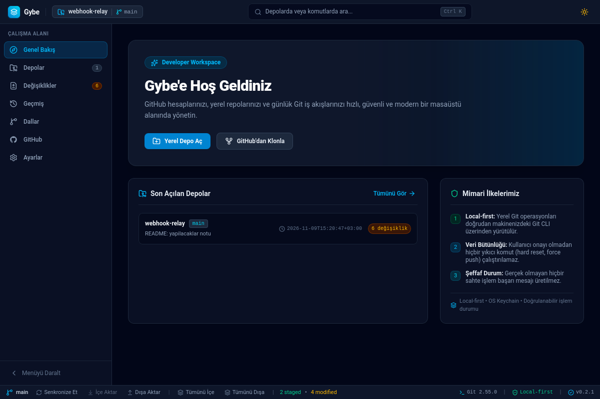
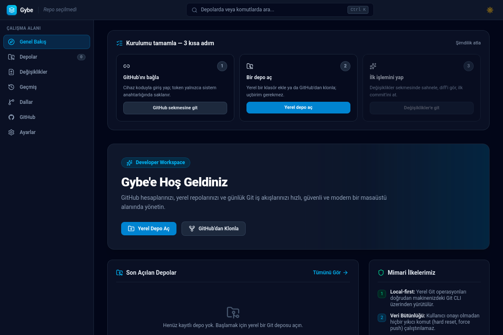
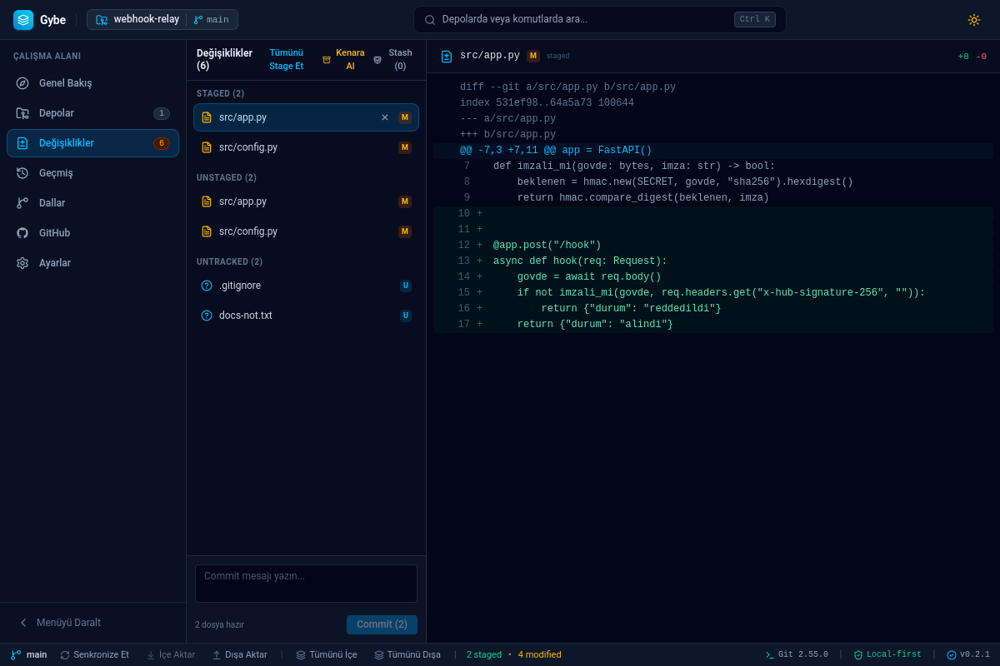
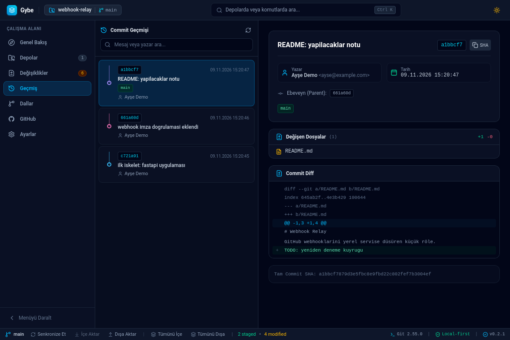
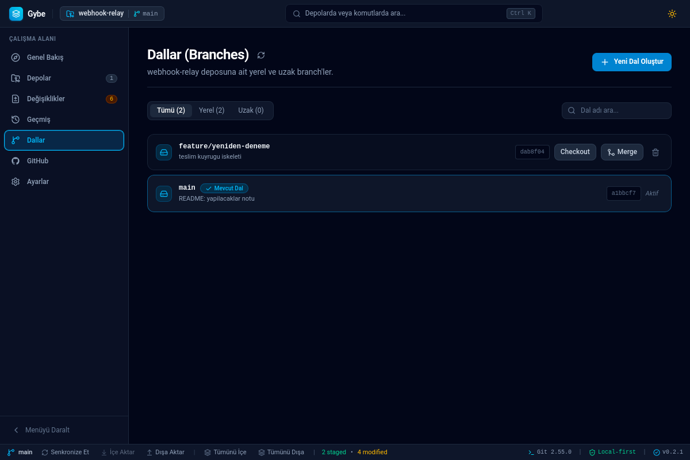
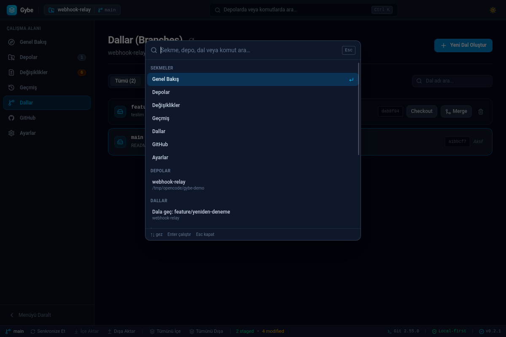

# Gybe — Developer Workspace

**English** · [Türkçe](README.tr.md)

> An open-source desktop app that brings your local Git workflow and GitHub
> account management into a single window — without your data ever leaving
> the machine.
>
> **Status:** v0.2.2 · **License:** MIT · **Platforms:** Linux (AppImage/.deb)
> · macOS (universal .dmg) · Windows (.exe) — macOS/Windows packages are
> unsigned; first-launch instructions ship in the release text
>
> **Download:** [GitHub Releases](https://github.com/gybeio/gybe/releases)
> — grab the installer for your OS.

Gybe aims to be more than "another Git GUI": it's a multi-repo **workspace**.
You register your repositories; Gybe watches remotes in the background and
surfaces what changed via badges, while you run the commit → branch → merge →
push chain without ever opening a terminal. The app is fully local: no
required account, no telemetry, no cloud sign-in — GitHub integration is 100%
optional.

The desktop shell is **Tauri 2**, the UI is **React 19 + TypeScript +
Tailwind CSS v4**, and the Git/system core is **Rust** (`gybe-core`). Git
operations run your system `git` (no `libgit2`) and parse its machine-readable
output (`--porcelain=v2`, `-z`) — Gybe is a visual extension of the Git you
already use on the command line, not a magic parallel world.

> **Heads-up:** the interface is currently **Turkish-only** (error messages
> included — it was designed Turkish-first). An English UI is on the roadmap.

## 📸 Screenshots

| Overview & workspace                       | First-run guide                                |
| ------------------------------------------ | ---------------------------------------------- |
|  |  |
| **Staging & line-level diff**              | **History & commit graph**                     |
|    |        |
| **Branches**                               | **Command palette (Ctrl+K)**                   |
|  |        |

---

## 🗺️ What Does It Do? (Feature Map)

### Overview & Repositories

- **Multi-repo catalog:** SQLite-backed repository index; add via
  drag-and-drop, missing-folder detection (relink), path-conflict checks.
- **Pinning + search/filter:** pinned repos sit at the top of the list; search
  matches name/path/branch and composes with pin order.
- **Folder drag-and-drop:** drop a plain folder onto the window and get
  "open as repo / init / publish on GitHub" options.
- **First-run guide:** on a fresh install, a 3-step onboarding (connect GitHub
  → open a repo → first action); step checkmarks are read from the real
  account/repo list — never faked.

### Changes

- **Single-call status engine:** `git status --porcelain=v2 --branch -z` —
  files, branch, upstream and ahead/behind in one subprocess; renames and
  paths with spaces parse byte-exactly via an offset-based parser.
- **Line-level diff viewer:** colored unified diff; binary files and huge
  diffs (>512 KB) get a transparent "truncated" badge (output is capped in
  memory — no RAM explosions).
- **Stage / unstage / discard:** discard asks for a second confirmation and
  rescans the repo one more time (the operation stops if anything changed in
  between).
- **Ignore:** one click on an untracked line writes to `.gitignore`
  (versioned) or `.git/info/exclude` (this machine only). Patterns are pinned
  to the repo root, and `git check-ignore` verifies the rule actually takes
  effect; linked worktrees and submodule dirs write to the correct
  `--git-common-dir` target.
- **Stash hub:** named stashes, optional untracked inclusion; Pop / Apply /
  confirmed Delete per entry. On conflict the **stash is not dropped** — the
  recoverable state is preserved.
- **Conflict helper band:** during a merge/rebase conflict: X/Y progress
  counter, per-file "Ours / THEIRS / Resolve in editor" actions, and a
  two-step confirmed "Abort".

### History

- **Commit graph:** lane assignment is a pure function in the core;
  merge/octopus junctions rendered as SVG ribbons with a stable palette
  derived from the SHA.
- **Branch/tag badges**, clickable parent SHAs, paginated list.
- **Controlled amend:** only the latest, **not-yet-pushed** commit's message
  is editable (pushed commits are rejected with `AMEND_PUSHED`); messages pass
  an ANSI/control-character gate.

### Branches

- Local/remote branch hierarchy, one-click checkout/create/delete/merge,
  forced-vs-blocked distinction when deleting unmerged branches, and
  abort/rebase state detected from on-disk metadata (not stderr guessing).
- Checkout in a dirty worktree stops **with data-loss protection**; you see
  what happened and your options.

### GitHub

- **OAuth Device Flow (RFC 8628):** browser + code sign-in, no client secret;
  client-side rate limiting and `slow_down` compliance (±5s backoff).
- **Automatic token refresh:** the refresh grant is attempted 2 minutes before
  the access token expires; rotated refresh keys are updated in the OS
  keyring; a refused refresh marks the account with a "reconnect" suggestion.
- **Publishing repos:** pick account/visibility/description, then the remote
  is attached and the folder is registered — all in one flow.

### App-wide

- **Auto-check (auto-fetch):** every repo is fetched at a 1–60 min interval;
  ↑/↓ badges stay live. **A pull is never automatic.**
- **Sync all:** a round that pulls/pushes every repo in sequence, with a
  progress modal, a stop button, and a per-repo ✓/⏭/✗ report. Locked repos
  aren't waited on — they're skipped.
- **Command palette (Ctrl+K / Ctrl+Shift+P):** fuzzy search across tabs,
  repos, branches and actions; the last 5 commands are remembered.
- **OS notifications:** long jobs (clone/publish/push rejection) notify while
  the window is in the background; no notifications while focused.
- **Accessibility:** every modal has a focus trap + Escape + focus restore to
  the trigger on close; `prefers-reduced-motion` support; landmark and
  aria-live infrastructure — all locked by tests.
- **Single instance:** opening a second window raises the existing one; the
  database stays single-process.

---

## 🆚 How Is It Different From the Competition?

An honest framing first: Gybe does **not** do everything its competitors do
(see the "Deliberate Limits" table below). Its claim: **it does what it does
in an order that respects your data and your attention.**

| Dimension                 | Common industry practice                                                                                                                | Gybe                                                                                                                                                                                                                                    |
| ------------------------- | --------------------------------------------------------------------------------------------------------------------------------------- | --------------------------------------------------------------------------------------------------------------------------------------------------------------------------------------------------------------------------------------- |
| **Credentials**           | Tokens usually land in a vendor vault/cloud account, a config file, or the OS store via "helpers"; many tools require an account anyway | Token and refresh key live **only in the OS keyring**; they exist in a per-operation process environment (a `GIT_ASKPASS` pipe); they are **never** written to disk/URLs/SQLite/logs. An OAuth app secret doesn't architecturally exist |
| **Account/telemetry**     | Vendor accounts (Atlassian/GitKraken etc.) and remote analytics are the norm                                                            | Zero account required from install to first commit; GitHub connection is 100% optional; no telemetry                                                                                                                                    |
| **Data loss**             | `--force`, `reset --hard`, one-click silent "discard" are common shortcuts                                                              | **No** automatic force on non-fast-forward pushes; checkout is blocked on a dirty worktree; discard/stash-drop/merge-abort are double-confirmed; the stash survives conflicts; amend is limited to local commits                        |
| **Error honesty**         | "Success" banners on partially-failed operations; swallowed `recovery_hint`s                                                            | Success only ever comes from the real backend response; errors render from one place (`lib/errors`) with code + original message + **recovery hint**; an expired token is never masked as "unknown error"                               |
| **Approach to Git**       | Embedded libraries (libgit2) or shell-string concatenation; silent deviations in corner cases                                           | Your system `git`, always with an argument array + NUL-delimited machine output; old-path fallback on unexpected formats; subprocess management with timeout + process-group kill + pipe-drain                                          |
| **Worktree / submodules** | The "`​.git​` is a directory" assumption breaks often                                                                                   | In linked worktrees and submodules `.git` is a **file**; the git dir is always resolved via `rev-parse --git-common-dir` (tested)                                                                                                       |
| **Performance profile**   | Heavy Electron history; every panel triggers its own subtree scan                                                                       | Tauri core + a single status call, capped diff reads, stale-response race guards, IPC commands run off the event loop                                                                                                                   |
| **Audit transparency**    | Security claims are usually marketing sentences                                                                                         | End-to-end audit (findings identified as GO-xx core · CB-xx UI · R-xx risk) → closed in 9 work packages; every finding locked by a targeted regression test (traceable by ID in commit history)                                         |
| **Language**              | Turkish support, where it exists at all, is a community patch                                                                           | The UI was designed Turkish-first (including error copy)                                                                                                                                                                                |

Positioning in one line: the simplicity of **GitHub Desktop** + the
multi-repo workflow of **Fork/Sourcetree** + the daily-life quality of
**GitButler** — **without GitKraken-style account/cloud lock-in**, and open
source. The terminal remains the most powerful tool; Gybe doesn't try to
replace it, it tries to remove the friction.

---

## 🚫 Deliberate Limits (What We Don't Do)

| Not doing                               | Why                                                                                                                                                                                                                                            |
| --------------------------------------- | ---------------------------------------------------------------------------------------------------------------------------------------------------------------------------------------------------------------------------------------------- |
| Interactive rebase, cherry-pick UI      | High destructiveness; far safer control in the terminal                                                                                                                                                                                        |
| Inline (3-pane) merge editor            | Resolving complex content is the editor's job; Gybe gives you side-switching and tracking                                                                                                                                                      |
| Automatic `git push --force`, auto-pull | No destructive/unrequested operation without explicit user consent                                                                                                                                                                             |
| Repo groups/labels CRUD UI              | Scope management; the terminal stays free                                                                                                                                                                                                      |
| Cloud sync, collaboration features      | Local-first architecture; you own your data                                                                                                                                                                                                    |
| Signed/notarized packages               | No signing/notary infrastructure. Packages ship on all three platforms but **unsigned** — the release text walks you through the one-time Gatekeeper/SmartScreen prompt. Paid signing (Developer ID / OV-EV cert) would reopen `docs/adr/0005` |

---

## 🏗️ Architecture

```
┌──────────────────────────────────────────────────────────┐
│  React 19 UI (features/: Welcome · Repositories ·        │
│  Changes · History · Branches · GitHub · Settings)       │
│  command palette · toasts · modal a11y (useDialogA11y)   │
├──────────────── IPC (invoke) — 58 typed commands ────────┤
│  src-tauri: Tauri 2 shell, command routing,              │
│  single-instance, CSP, OS notification/dialog plugins    │
├──────────────────────────────────────────────────────────┤
│  gybe-core (Rust)                                        │
│  git/    status · diff · commit · branch · merge · stash │
│          · remote · ignore · graph · history · adapter   │
│  services/  RepositoryService · GitHubService            │
│  db/        SQLite catalog (WAL) + migrate               │
│  credential_store.rs  OS keyring (access + refresh)      │
│  sync.rs  sync-all planner (pure function)               │
├──────────────────────────────────────────────────────────┤
│  System git CLI (subprocess, separate arg list,          │
│  GIT_TERMINAL_PROMPT=0, GIT_ASKPASS pipe, timeout,       │
│  process-group kill) · OS keyring · filesystem           │
└──────────────────────────────────────────────────────────┘
```

**Where does data get written?**

| Data                          | Location            | Note                                                |
| ----------------------------- | ------------------- | --------------------------------------------------- |
| Repo catalog, recents, pins   | SQLite (`app_data`) | WAL + `busy_timeout`; contains **no** tokens        |
| OAuth access + refresh tokens | **OS keyring only** | Expiry timestamp in the DB; the key itself never    |
| App state                     | SQLite              | Correlation-ID logging writes sensitive data masked |

**Race-condition defenses (all tested):** per-IPC seq-guarded stale-response
filters, `refresh_lock` preventing concurrent token refresh, poison-mutex
recovery, auto-fetch round-overlap protection.

---

## 🔒 Security Principles

1. **Zero-token storage.** The OAuth token and refresh key live only in the OS
   keyring. They cannot enter IPC responses, log lines, URLs, or SQLite
   (a redaction layer + shape-based scrubbing enforce this).
2. **Least injection.** The token is injected only into the child Git
   process's environment, and only when the target remote is actually HTTPS
   (including `GIT_CONFIG_*` resets of stored helpers). Over SSH,
   `~/.ssh/config` stays in charge.
3. **Destructive ops need explicit consent.** Discard, stash-drop,
   merge/rebase abort, force-delete: all confirmed; checkout halts on a dirty
   worktree; a non-fast-forward push never turns into a force on its own.
4. **Honest UI.** A failed operation can never look "successful"; states like
   AUTH_EXPIRED are shown with a message that tells you what to do next.
5. **Input hardness.** Revision/stash/branch names and file paths are
   validated (`..`, absolute paths, control characters and ANSI escapes are
   rejected); commit messages pass a control-character gate.
6. **Process hygiene.** Every Git subprocess runs with timeout +
   process-group kill + pipe-drain; a Git asking for credentials never hangs
   (`GIT_ASKPASS=echo`).
7. **Secure default CSP.** `connect-src` is IPC-only; no dev-server
   exceptions in the production policy.

Details and disclosure policy: `SECURITY.md`,
`docs/adr/0002-os-credential-store.md`.

---

## 🧪 Quality Gates

Current green state (numbers verified in this repo):

| Gate                          | Command                                                                              | Status                   |
| ----------------------------- | ------------------------------------------------------------------------------------ | ------------------------ |
| Rust core (unit + acceptance) | `cargo test --manifest-path crates/gybe-core/Cargo.toml --features test-support`     | **111 tests**            |
| Tauri shell                   | `cargo test` (`src-tauri/`)                                                          | 3 tests                  |
| Frontend unit/component/a11y  | `npm test` (Vitest)                                                                  | **129 tests / 26 files** |
| Type checking                 | `npm run typecheck`                                                                  | clean                    |
| Production build              | `npm run build`                                                                      | clean                    |
| Format + lint                 | `npm run format:check` · `npm run lint` · `cargo fmt --check` · `clippy -D warnings` | clean                    |

The tests don't just say "it works" — they encode behavioral contracts: e.g.
paths with spaces/renames in the v2 status parser, `--- ` lines inside a hunk
body not being treated as diff headers, ignore rules verifiably taking effect
in worktrees (via `check-ignore`), the stash surviving a conflict, dialogs
closing on Escape and returning focus.

**Audit history:** after v0.2.1 we ran an end-to-end
security/performance/accessibility audit; every finding (identified as GO-xx
core, CB-xx UI, R-xx risk) was closed in work packages WP-0…WP-8, each locked
by a targeted regression test (traceable in commit messages).

---

## 🛠️ Getting Started & Development

### Prerequisites

- Node.js `v20+` (recommended `v22 LTS`) and npm `v10+`
- Rust stable (`1.80+`)
- Git CLI `2.23+` (recommended `2.40+`; see `docs/adr/0003-minimum-git-surumu.md`)

Linux (Debian/Ubuntu) system packages:

```bash
sudo apt update
sudo apt install -y build-essential pkg-config libssl-dev libdbus-1-dev \
  libwebkit2gtk-4.1-dev libayatana-appindicator3-dev librsvg2-dev
```

### Running

```bash
npm install
npm run tauri dev      # development (Vite HMR + Rust hot-rebuild)
npm run tauri build    # production build
```

> Dev shortcut: thanks to `build.additionalWatchFolders: ["../crates"]` in
> `tauri.conf.json`, `tauri dev` rebuilds whenever `gybe-core` changes. (The
> key name is deliberately the old camelCase form: the schema of the installed
> `@tauri-apps/cli` 2.12.4 doesn't know the newer kebab-case name yet;
> `tauri-utils` 2.10 accepts both.)

### GitHub OAuth (optional)

Local Git features need neither internet nor a GitHub account. The default
`client_id` points at the OAuth app registered under the
[gybeio](https://github.com/gybeio) organization. If you want Device Flow
through your own app (forks, org policy…), point it at your `client_id`
instead (per RFC 8628 the `client_id` is not a secret; **no secret is ever
used**):

```bash
GYBE_GITHUB_CLIENT_ID=<CLIENT_ID> npm run tauri dev
```

### Contribution rules

- One work package = one commit; relevant gates run before committing.
- **Both READMEs are updated after every work package** (`README.md` English +
  `README.tr.md` — feature map, gate numbers, limits table stay in lockstep),
  codified as a standing rule in `AGENTS.md`.
- No pushing without user consent; destructive Git operations are not added to the UI.

Details: `CONTRIBUTING.md` · `AGENTS.md`.

---

## 📁 Project Structure

```text
Gybe/
├── .github/workflows/          # Multi-platform CI + tag-triggered release
├── AGENTS.md                   # Standing dev rules (agent + human)
├── CHANGELOG.md                # Release history
├── CONTRIBUTING.md             # Contribution guide and quality gates
├── SECURITY.md                 # Vulnerability disclosure policy
├── README.md / README.tr.md    # This file / Turkish original
├── crates/gybe-core/           # Rust core: git engine, SQLite, keyring
│   ├── src/{git,db,services}/  #   + credential_store, sync planner
│   └── tests/                  # acceptance tests + audit regressions
├── docs/
│   ├── adr/                    # ADR-0001 Device Flow · 0002 Keyring · 0003 Git version · 0004/0005 Packaging+Release
│   ├── screenshots/            # README screenshots (demo repo)
│   ├── KULLANIM_v0.2.md        # user guide for v0.2 features (Turkish)
│   ├── RELEASE_NOTES_*.md · RELEASE_CHECKLIST.md
│   └── LICENSE_INVENTORY.md
├── src/                        # React 19 UI
│   ├── components/{common,layout}/   # palette, modals, Shell, Sidebar…
│   ├── features/               # welcome · repositories · changes · history · branches · github · settings
│   ├── lib/                    # tauriCommands (IPC) · errors.ts · useDialogA11y · useAutoFetch…
│   ├── test/                   # e2e + accessibility contract tests
│   └── types/                  # IPC type contracts
├── src-tauri/                  # Tauri 2 shell + command routing
└── vite.config.ts              # Vite + Vitest + Tailwind v4
```

---

## 🕘 Version Summary

| Version     | Theme                           | Summary                                                                                                                                                                                                                                                                                                        |
| ----------- | ------------------------------- | -------------------------------------------------------------------------------------------------------------------------------------------------------------------------------------------------------------------------------------------------------------------------------------------------------------- |
| **v0.1**    | Core                            | Repo catalog, status/diff/stage/commit, branch management, push/fetch/pull, Device Flow + keyring, history list, CI                                                                                                                                                                                            |
| **v0.2**    | Daily use (12/12)               | ignore + stash, auto-fetch + OS notifications + controlled amend, command palette + drag-and-drop, commit graph, conflict band + sync-all, pin + onboarding                                                                                                                                                    |
| **v0.2.1**  | Security + audit + distribution | Transparent token refresh via refresh token; all audit findings (GO/CB/R) closed in 9 work packages (perf, data-loss gates, races, CSP, worktree ignore, focus a11y); tag-triggered Linux AppImage/.deb release channel                                                                                        |
| **v0.2.2**  | Cross-platform distribution     | Same release now also ships an unsigned **universal .dmg** (Apple Silicon + Intel) and a Windows **NSIS .exe**; bilingual first-launch guide (Gatekeeper/SmartScreen) appended to every release body; release creation rebuilt on `gh` so the body is the CHANGELOG slice (v0.2.1's showed the commit message) |
| **2026-11** | Rename                          | Project renamed **GitOrbit → Gybe** (name collision with an existing open-source Git client of the same name). Same product and codebase; the keyring service name and data dir changed, so existing installs need a one-time GitHub re-login and repo re-add                                                  |

---

## 📦 Distribution & License

Every release is published on
[GitHub Releases](https://github.com/gybeio/gybe/releases) with one
installer per platform:

| Platform                | File                 | First launch                                                                                  |
| ----------------------- | -------------------- | --------------------------------------------------------------------------------------------- |
| Linux (x86_64)          | `.AppImage` / `.deb` | Works as-is: `chmod +x Gybe_*_amd64.AppImage && ./…` or `sudo apt install ./Gybe_*_amd64.deb` |
| macOS (Silicon + Intel) | `_universal.dmg`     | **Unsigned** → right-click the app → **Open** (one time)                                      |
| Windows (x64)           | `_x64-setup.exe`     | **Unsigned** → SmartScreen → **"More info" → "Run anyway"** (one time)                        |

The AppImage does not bundle GTK/WebKit libraries; the system packages above
are still required (see Getting started): `libwebkit2gtk-4.1`, `libdbus-1`,
`libayatana-appindicator3`.

**Honest notes (see `docs/adr/0005`):** all packages are **unsigned** — there
is no GPG signing, Apple notarization, or Windows code-signing certificate,
and the release text says so up front (the table above is auto-appended to
every release). We publish unsigned installers rather than nothing, and we
tell you exactly which one-time warning to click past; building from source
(`npm ci && npm run tauri build`) works everywhere if you'd rather verify.
There is no auto-updater — you download updates from the Releases page.

Release history: `CHANGELOG.md` · packaging decisions: `docs/adr/0004`,
`docs/adr/0005` · publishing pipeline: `.github/workflows/release.yml`
(`v*` tag push → automatic).

MIT license · dependency license compliance in `docs/LICENSE_INVENTORY.md` ·
security issues via `SECURITY.md`.
