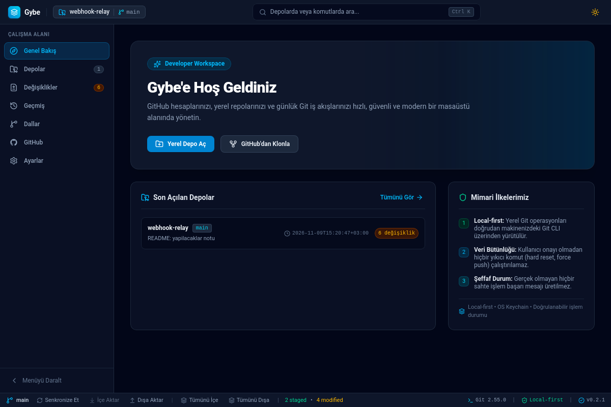
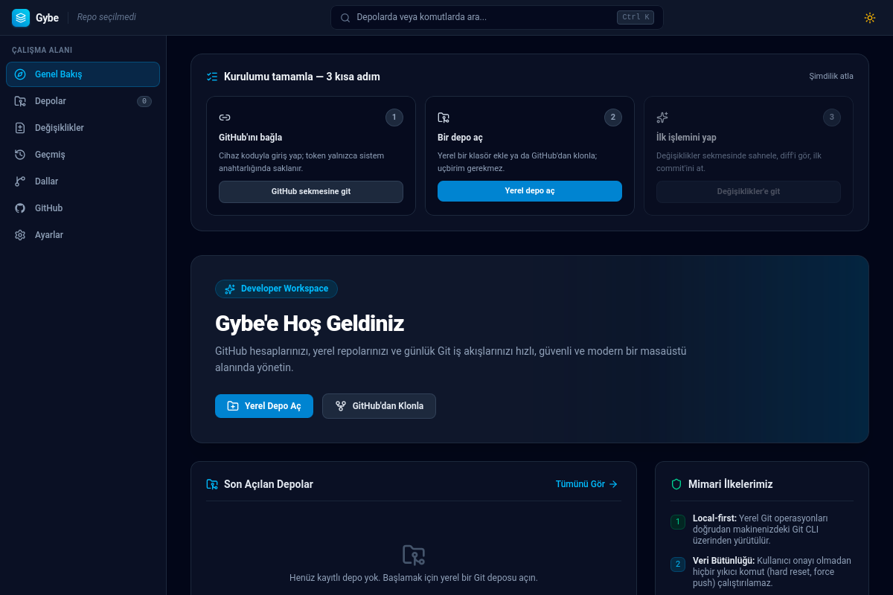
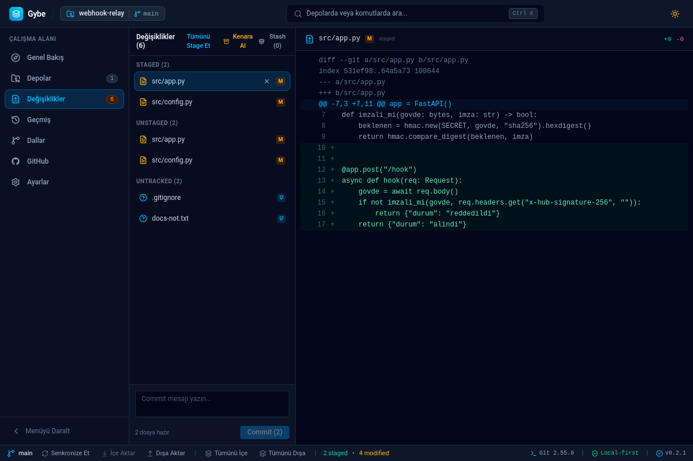
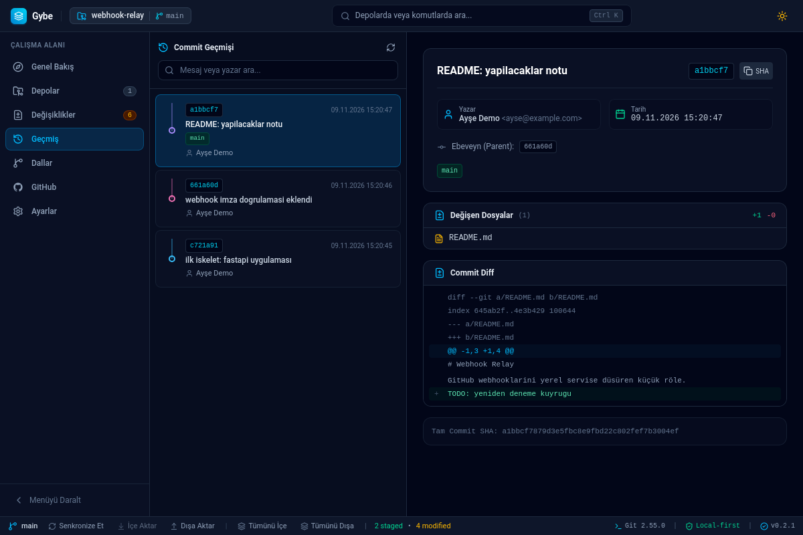
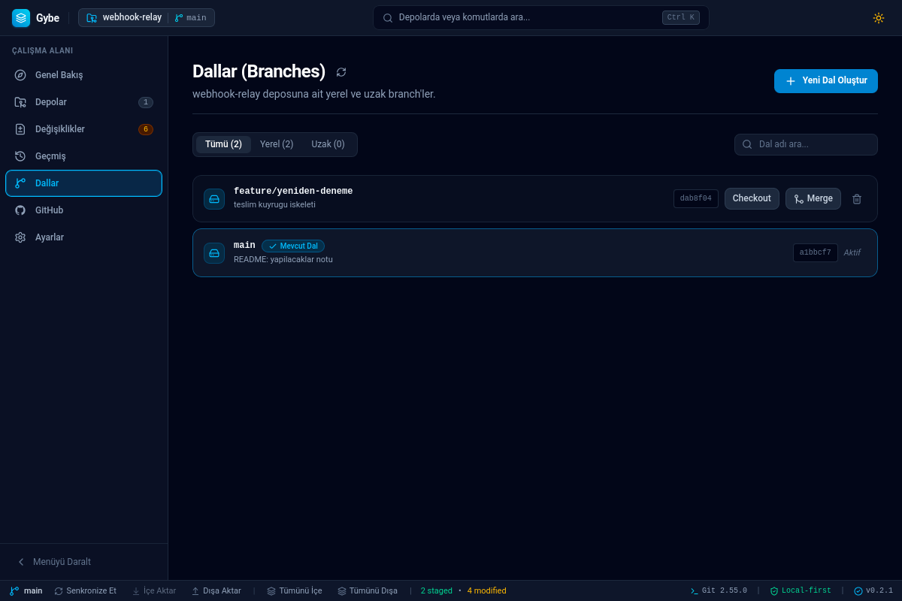
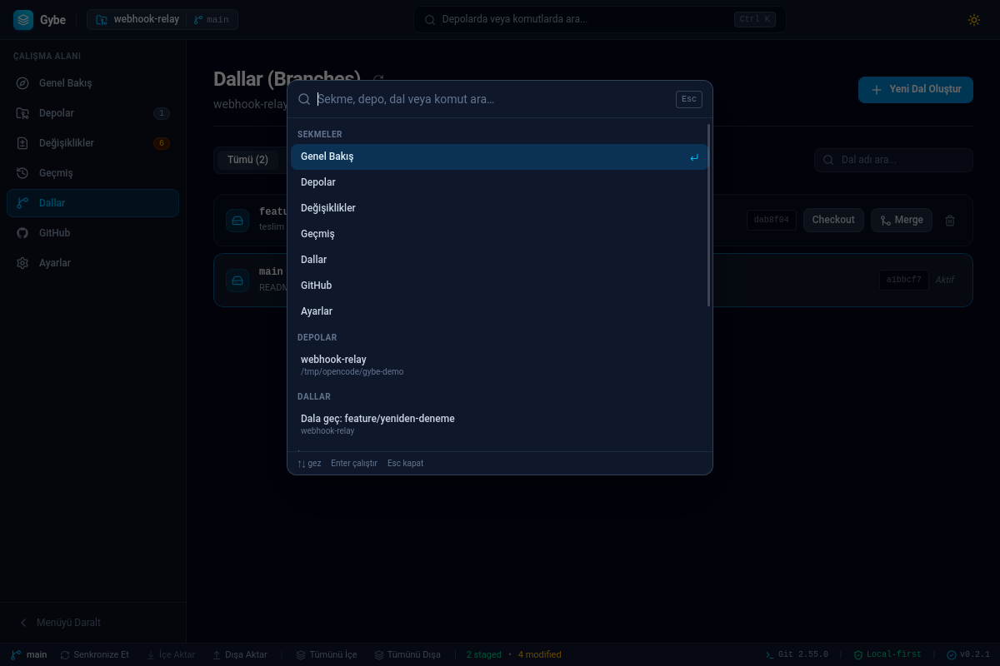

# Gybe — Developer Workspace

**[English](README.md)** · Türkçe

> Yerel Git iş akışlarını ve GitHub hesap yönetimini, hiçbir verini dışarıda
> bırakmadan tek pencerede toplayan, açık kaynaklı masaüstü uygulaması.
>
> **Durum:** v0.2.1 · **Lisans:** MIT · **Platformlar:** Linux (AppImage/.deb
> hazır) · macOS · Windows (kaynaktan)
>
> **İndir:** [GitHub Releases](https://github.com/burakcnaksy0/gybe/releases)
> — `Gybe_x.y.z_amd64.AppImage` indir, `chmod +x` yap, çalıştır.

Gybe bir "git GUI'si"nden fazlasını hedefler: çok depolu bir **çalışma
alanı**. Depolarını tanımlarsın; Gybe arka planda uzaktan gelen
değişiklikleri izler, rozetlerle bildirir, sen de commit → branch → merge →
push zincirini terminal açmadan yürütürsün. Uygulama tamamen yereldir:
hesap zorunluluğu yok, telemetri yok, bulut hesabı yok — GitHub entegrasyonu
tamamen isteğe bağlıdır.

Masaüstü kabuğu **Tauri 2**, arayüz **React 19 + TypeScript + Tailwind CSS v4**,
Git/sistem çekirdeği **Rust** (`gybe-core`). Git işlemleri `libgit2`
bağımlılığı olmadan, sistem `git`'inin makine-okunur çıktısı (`--porcelain=v2`,
`-z`) ayrıştırılarak yapılır — yani Gybe, komut satırındaki Git'in
görsel bir uzantısıdır; sihirli bir paralel dünya değil.

## 📸 Görseller

| Genel bakış ve çalışma alanı                   | İlk kurulum rehberi                           |
| ---------------------------------------------- | --------------------------------------------- |
|   |  |
| **Stage'leme ve satır bazlı diff**             | **Geçmiş ve commit grafiği**                  |
|  |        |
| **Branch'ler**                                 | **Komut paleti (Ctrl+K)**                     |
|    |         |

---

## 🗺️ Neler Yapıyor? (Özellik Haritası)

### Genel Bakış ve Depolar

- **Çok depolu katalog:** SQLite tabanlı depo dizini; klasör sürükle-bırak ile
  ekleme, eksik klasör tespiti (relink), yol çakışması kontrolü.
- **Sabitleme (pin) + arama/filtre:** Sabitlenen depo listenin en üstünde;
  arama isim/yol/dal üzerinde çalışır, ikisi birlikte geçerli.
- **Klasör sürükle-bırak:** Düz klasörü pencereye bırakınca "depo olarak
  aç / başlat / GitHub'da yayınla" seçenekleri çıkar.
- **İlk çalışma rehberi:** Boş kurulumda 3 adımlık onboarding (GitHub bağla →
  depo aç → ilk işlem); gerçek hesaptan/depo listesinden okunan durum tikleri.

### Değişiklikler (Changes)

- **Tek çağrılı status motoru:** `git status --porcelain=v2 --branch -z` —
  dosyalar, dal, upstream ve ahead/behind tek subprocess'te gelir; rename ve
  boşluklu yollar byte-ofsetli ayrıştırıcıyla birebir doğru.
- **Satır düzeyi diff görüntüleyici:** renkli unified diff, ikili dosya ve
  512 KB üstü dev diff'ler için saydam "kırpıldı" rozeti (çıktı belleğe
  sınırla alınır; RAM patlamaz).
- **Stage / unstage / discard:** discard ikinci bir onay ister ve depoyu
  son bir kez daha tarar (arada başka bir şey değiştiyse işlem durur).
- **Yoksay (ignore):** untracked satırdan tek tıkla `.gitignore` (versiyonlu)
  veya `.git/info/exclude` (yalnız bu makine). Desen köke sabitlenir,
  yazıldıktan sonra `git check-ignore` ile gerçekten etkili olduğu doğrulanır;
  linked worktree ve alt modül dizinlerinde doğru `--git-common-dir` hedefine
  yazar.
- **Stash merkezi:** açıklamalı stash, untracked dahil etme; girdi başına
  Pop / Apply / onaylı Sil. Çakışma çıkarsa **stash silinmez** — geri
  alınabilir durum korunur.
- **Çakışma yardımcı bandı:** merge/rebase çakışmasında X/Y ilerleme sayacı,
  dosya başına "Bizimki / THEIRS / Editörde çöz" eylemleri, iki adımlı
  onaylı "İptal Et".

### Geçmiş (History)

- **Commit grafiği:** lane hesabı çekirdekte saf fonksiyon; merge/octopus
  kavşakları SVG şeritlerle, renkler SHA'dan türeyen kararlı palet.
- **Dal/tag rozetleri**, tıklanabilir ebeveyn SHA'ları, sayfalı liste.
- **Kontrollü amend:** yalnızca en son ve **henüz push edilmemiş** commit'in
  mesajı düzenlenebilir (push edilmişse `AMEND_PUSHED` ile reddedilir);
  commit mesajı ANSI/kontrol karakteri kapısından geçer.

### Dallar (Branches)

- Yerel/uzak dal hiyerarşisi, tek tık checkout/create/delete/merge,
  unmerged dal silmede zorlama ayrımı, abort/rebase durumunun dizin
  meta verisinden tespiti (stderr tahmini değil).
- Kirli çalışma ağacında checkout **veri kaybı korumasıyla** durur; kullanıcı
  ne olduğunu ve seçeneklerini görür.

### GitHub

- **OAuth Device Flow (RFC 8628):** tarayıcı + kod ile giriş, client secret
  yok; istemci tarafı hız sınırlama ve `slow_down` uyumu (±5 sn backoff).
- **Otomatik token yenileme:** access token bitmeden 2 dk önce refresh grant
  denenir; rotlanan refresh anahtarı keyring'de güncellenir; yenileme
  reddedilirse hesap "yeniden bağlan" önerisiyle işaretlenir.
- **Depo yayınlama:** hesap/visibility/açıklama seçimi, yayınlanınca
  remote'un bağlanması ve klasörün depo olarak eklenmesi tek akışta.

### Uygulama Geneli

- **Otomatik kontrol (auto-fetch):** 1–60 dk aralıkla tüm depolar fetch
  edilir; ↑/↓ rozetleri canlılanır. **Pull asla otomatik değildir.**
- **Tümünü eşitle:** tüm depoları sırayla içe/dışa aktaran tur; ilerleme
  modalı, durdurma, depo depo ✓/⏭/✗ raporu. Kilitli depo beklenmez, atlanır.
- **Komut paleti (Ctrl+K / Ctrl+Shift+P):** sekmeler, depolar, dallar ve
  işlemler üzerinde fuzzy arama; son 5 komut hatırlanır.
- **OS bildirimleri:** clone/yayınlama/push reddi gibi uzun işler pencere
  arkadayken bildirir; pencere odaklıyken bildirim gelmez.
- **Erişilebilirlik:** tüm modallar odak tuzağı + Escape + kapanışta odağın
  tetikleyiciye dönmesi; `prefers-reduced-motion` desteği; landmark ve
  aria-live altyapısı — testlerle kilitli.
- **Tek örnek (single-instance):** ikinci pencere açılırsa mevcut pencere
  öne alınır; veritabanı tek süreçten yönetilir.

---

## 🆚 Rakiplerden Farkı — Neyi Farklı Yapıyoruz?

Önce dürüst çerçeve: Gybe, rakiplerinin yaptığı **her** şeyi yapmıyor
(aşağıdaki "Bilinçli Sınırlar" tablosuna bak). İddiası şu: **yaptığı işi,
kullanıcının verisine ve dikkatine saygı gösteren bir sıralamayla yapıyor.**

| Boyut                    | Sektörde yaygın durum                                                                                                                          | Gybe                                                                                                                                                                                                                    |
| ------------------------ | ---------------------------------------------------------------------------------------------------------------------------------------------- | ----------------------------------------------------------------------------------------------------------------------------------------------------------------------------------------------------------------------- |
| **Kimlik bilgisi**       | Token'lar genelde kendi vault'una/cloud hesabına, config'e ya da OS depolayıcısına "yardımcı" ile yazılır; birçok araç hesap açmayı şart koşar | Token ve refresh anahtarı **yalnızca işletim sistemi anahtarlığında**; işlemeye özel süreç ortamında (`GIT_ASKPASS` tüpü ile) yaşar; diske/URL'e/SQLite'a/log'a **asla** yazılmaz. OAuth App secret'ı mimari olarak yok |
| **Hesap/telemetri**      | Üretici hesabı (Atlassian/GitKraken vs.) ve uzaktan analitik yaygın                                                                            | Kurulumdan ilk commit'e kadar hesap zorunluluğu yok; GitHub bağlantısı %100 isteğe bağlı; telemetri yok                                                                                                                 |
| **Veri kaybı**           | `--force`, `reset --hard`, "discard" tek tık ve sessiz sık karşılaşılan kısayollar                                                             | Non-fast-forward push'ta otomatik force **yok**; kirli worktree checkout'u engeller; discard/stash-drop/merge-abort çift onaylı; stash çakışmada korunur; amend yalnızca yerel commit'le sınırlı                        |
| **Hata dürüstlüğü**      | "Başarılı" yazıp kısmi kalan işlemler, yutulan `recovery_hint`'ler                                                                             | Başarı yalnızca gerçek backend yanıtından gelir; hatalar kod + özgün açıklama + **kurtarma ipucu** ile tek merkezden (`lib/errors`) gösterilir; süresi dolmuş token "bilinmeyen hata" diye maskelenmez                  |
| **Git'e yaklaşım**       | Gömülü kütüphane (libgit2) ya da kabuk string birleştirme; köşeli vakalarda sessiz sapmalar                                                    | Sistem `git`'i, daima ayrı argüman listesi + NUL-ayraçlı makine çıktıları; beklenmeyen biçimde eski-yol fallback; process-group kill + pipe-drain + timeout'lu subprocess yönetimi                                      |
| **Worktree / alt modül** | `.git` dizini "dizindir" varsayımı sık kırılır                                                                                                 | Linked worktree ve alt modüllerde `.git` bir **dosyadır**; git dizini her zaman `rev-parse --git-common-dir` ile çözülür (testli)                                                                                       |
| **Performans profili**   | Ağır Electron geçmişi; her panel ayrı subtree taraması                                                                                         | Tauri çekirdeği + tek status çağrısı, sınırlı diff okuma, bayat-yanıt yarış korumaları, IPC komutları olay döngüsü dışında                                                                                              |
| **Denetim şeffaflığı**   | Güvenlik iddiaları genelde pazarlama cümlesidir                                                                                                | Uçtan uca denetim (GO-xx çekirdek · CB-xx arayüz · R-xx risk kimlikli bulgular) → 9 iş paketinde kapatıldı; her bulgu hedefli regresyon testiyle kilitli (commit geçmişinde kimlikleriyle izlenebilir)                  |
| **Dil**                  | TR çevirisi ya yok ya topluluk yaması                                                                                                          | Arayüz Türkçe-first tasarlandı (hata metinleri dâhil)                                                                                                                                                                   |

Konumlandırma özeti: **GitHub Desktop**'un sadeliği + **Fork/Sourcetree**'nin
çok depolu iş akışı + **GitButler**'ın günlük yaşam kalitesi — bunları
**GitKraken tarzı hesap/cloud bağımlılığı olmadan** ve açık kaynak olarak
hedefler. Terminal hâlâ en güçlü araçtır; Gybe onu ikame etmeye değil,
sürtünmeyi kaldırmaya çalışır.

---

## 🚫 Bilinçli Sınırlar (Yapmadıklarımız)

| Yapılmıyor                                    | Neden                                                                                                                                                                               |
| --------------------------------------------- | ----------------------------------------------------------------------------------------------------------------------------------------------------------------------------------- |
| Etkileşimli rebase, cherry-pick UI'ı          | Yüksek yıkıcılık, terminalde çok daha güvenli kontrol                                                                                                                               |
| Satır içi (3 panelli) merge editörü           | Karma içerik çözümü editörün işi; Gybe tarafa geçişi ve takibi verir                                                                                                                |
| Otomatik `git push --force`, otomatik pull    | Kullanıcı onayı olmayan yıkıcı/istem dışı işlem ilkesi                                                                                                                              |
| Depo grupları/etiket CRUD arayüzü             | Kapsam yönetimi; terminal serbest                                                                                                                                                   |
| Bulut senkronizasyonu, iş birliği özellikleri | Yerel-ilk mimari; veri sahibi kullanıcı                                                                                                                                             |
| İmzalı/notarize paketler                      | İmza/noter altyapısı yok; paketler **imzasız** yayınlandığı Release metninde açıkça yazar. Linux'ta neden AppImage+.deb, macOS/Windows'ta neden hiç paket olmadığı: `docs/adr/0005` |

---

## 🏗️ Mimari

```
┌──────────────────────────────────────────────────────────┐
│  React 19 UI (features/: Welcome · Repositories ·        │
│  Changes · History · Branches · GitHub · Settings)       │
│  komut paleti · toast · modal a11y (useDialogA11y)       │
├──────────────── IPC (invoke) — 58 tip-güvenli komut ─────┤
│  src-tauri: Tauri 2 kabuğu, komut yönlendirme,           │
│  single-instance, CSP, OS bildirim/dialog eklentileri    │
├──────────────────────────────────────────────────────────┤
│  gybe-core (Rust)                                    │
│  git/    status · diff · commit · branch · merge · stash │
│          · remote · ignore · graph · history · adapter   │
│  services/  RepositoryService · GitHubService            │
│  db/        SQLite katalog (WAL) + migrate               │
│  credential_store.rs  OS keyring (access + refresh)      │
│  sync.rs  Tümünü-eşitle planlayıcısı (saf fonksiyon)     │
├──────────────────────────────────────────────────────────┤
│  Sistem git CLI (subprocess, ayrı argüman listesi,       │
│  GIT_TERMINAL_PROMPT=0, GIT_ASKPASS tüpü, timeout,       │
│  process-group kill) · OS keyring · dosya sistemi        │
└──────────────────────────────────────────────────────────┘
```

**Veri nereye yazılır?**

| Veri                           | Konum                   | Not                                                          |
| ------------------------------ | ----------------------- | ------------------------------------------------------------ |
| Depo kataloğu, son açılan, pin | SQLite (`app_data`)     | WAL + `busy_timeout`; token **içermez**                      |
| OAuth access + refresh token   | **Yalnızca OS keyring** | Bitiş zamanı DB'de; anahtarın kendisi asla                   |
| Uygulama durumu                | SQLite                  | Korelasyon kimlikli loglama hassas veriyi maskeleyerek yazar |

**Yarış koşullarıyla mücadele (testli):** IPC başına seq-guard'lı bayat yanıt
filtreleri, eşzamanlı refresh'i engelleyen `refresh_lock`, poizon-mutex
kurtarması, auto-fetch tur üst üste binme koruması.

---

## 🔒 Güvenlik İlkeleri

1. **Zero-Token Storage.** OAuth token ve refresh anahtarı yalnızca işletim
   sistemi anahtarlığında. IPC yanıtlarına, log satırlarına, URL'lere ve
   SQLite'a giremezler (redaksiyon katmanı + şekil bazlı temizlik).
2. **En küçük enjekte.** Token, hedef remote gerçekten HTTPS ise ve yalnızca
   çocuk Git sürecinin ortamına verilir (`GIT_CONFIG_*` ile stored-helper
   sıfırlaması dâhil). SSH'ta `~/.ssh/config` devrededir.
3. **Yıkıcı işlem, açık onay.** Discard, stash-drop, merge/rebase abort,
   zorla silme: hepsi onaylı; checkout kirli worktree'de durur; non-fast-forward
   push kendi başına force'a dönüşmez.
4. **Dürüst arayüz.** Başarısız işlem "başarılı" görünemez; AUTH_EXPIRED gibi
   durumlar kullanıcıya ne yapacağını söyleyen mesajla gösterilir.
5. **Girdi sertliği.** Revizyon/stash/dal adları ve dosya yolları
   doğrulanır (`..`, mutlak yol, kontrol karakteri, ANSI kaçışı reddi);
   commit mesajları kontrol karakteri kapısından geçer.
6. **Süreç hijyeni.** Her Git subprocess'i zaman aşımı + process-group kill
   - pipe-drain ile yürür; kimlik soran Git asla askıda kalmaz
     (`GIT_ASKPASS=echo`).
7. **Güvenli varsayılan CSP.** `connect-src` yalnızca IPC; üretim
   politikasında dev sunucu istisnaları yok.

Detaylar ve bildirim politikası: `SECURITY.md`, `docs/adr/0002-os-credential-store.md`.

---

## 🧪 Kalite Kapıları

Şu anki yeşil durum (bu depoda doğrulanmış sayılar):

| Kapı                          | Komut                                                                                | Durum                   |
| ----------------------------- | ------------------------------------------------------------------------------------ | ----------------------- |
| Rust çekirdek (birim + kabul) | `cargo test --manifest-path crates/gybe-core/Cargo.toml --features test-support`     | **111 test**            |
| Tauri kabuk                   | `cargo test` (`src-tauri/`)                                                          | 3 test                  |
| Frontend birim/bileşen/a11y   | `npm test` (Vitest)                                                                  | **129 test / 26 dosya** |
| Tip denetimi                  | `npm run typecheck`                                                                  | temiz                   |
| Üretim derlemesi              | `npm run build`                                                                      | temiz                   |
| Biçim + lint                  | `npm run format:check` · `npm run lint` · `cargo fmt --check` · `clippy -D warnings` | temiz                   |

Testler yalnız "çalışıyor" demez; davranış sözleşmesi taşır — örneğin: v2
status ayrıştırıcısında boşluklu/rename yollar, hunk gövdesindeki `--- `
satırlarının diff başlığı sayılmaması, worktree'de ignore'un gerçekten etkili
olması (check-ignore ile), stash'in çakışmada silinmemesi, diyalogların Escape
ile kapanıp odağı geri vermesi.

**Denetim geçmişi:** v0.2.1 sonrasında uçtan uca güvenlik/performans/erişilebilirlik
denetimi yapıldı; GO-xx (çekirdek), CB-xx (arayüz), R-xx (risk) kimlikli
bulguların tamamı WP-0…WP-8 iş paketlerinde, her biri hedefli regresyon
testiyle kapatıldı (commit mesajlarında izlenebilir).

---

## 🛠️ Kurulum ve Geliştirme

### Ön koşullar

- Node.js `v20+` (önerilen `v22 LTS`) ve npm `v10+`
- Rust stable (`1.80+`)
- Git CLI `2.23+` (önerilen `2.40+`; bkz. `docs/adr/0003-minimum-git-surumu.md`)

Linux (Debian/Ubuntu) sistem paketleri:

```bash
sudo apt update
sudo apt install -y build-essential pkg-config libssl-dev libdbus-1-dev \
  libwebkit2gtk-4.1-dev libayatana-appindicator3-dev librsvg2-dev
```

### Çalıştırma

```bash
npm install
npm run tauri dev      # geliştirme (Vite HMR + Rust hot-rebuild)
npm run tauri build    # üretim derlemesi
```

> Geliştirme kısayolu: `tauri.conf.json` içindeki `build.additionalWatchFolders:
["../crates"]` sayesinde `gybe-core` kodu değişince `tauri dev` kendini
> yeniden derler. (Anahtar adı bilinçli olarak eski/camelCase: kurulu
> `@tauri-apps/cli` 2.12.4'ün şeması güncel kebab-case adını henüz tanımıyor;
> `tauri-utils` 2.10 her iki adı da kabul ediyor.)

### GitHub OAuth (isteğe bağlı)

Yerel Git özellikleri internet ve GitHub hesabı gerektirmez. Device Flow
kullanmak istersen kendi OAuth App'inin `client_id`'sını verebilirsin
(RFC 8628 gereği `client_id` sır değildir; **secret kullanılmaz**):

```bash
GYBE_GITHUB_CLIENT_ID=<CLIENT_ID> npm run tauri dev
```

### Katkı kuralları

- Bir iş paketi = bir commit; commit öncesi ilgili kapılar koşulur.
- **Her iş paketinden sonra her iki README güncellenir** (`README.md` İngilizce
  - `README.tr.md` — yetenek haritası, kalite kapısı sayıları, sınır tablosu
    aynı anda) — `AGENTS.md`'de kalıcı kural olarak duruyor.
- Kullanıcı onayı olmadan push yok; yıkıcı Git işlemi UI'a eklenemez.

Detaylar: `CONTRIBUTING.md` · `AGENTS.md`.

---

## 📁 Proje Yapısı

```text
Gybe/
├── .github/workflows/          # Multi-platform CI + tag tetiklikli release
├── AGENTS.md                   # Kalıcı geliştirme kuralları (agent + insan)
├── CHANGELOG.md                # Sürüm geçmişi
├── CONTRIBUTING.md             # Katkı rehberi ve kalite kapıları
├── SECURITY.md                 # Güvenlik açığı bildirim politikası
├── README.md / README.tr.md    # İngilizce çeviri / bu dosya (orijinal)
├── crates/gybe-core/           # Rust çekirdek: git motoru, SQLite, keyring
│   ├── src/{git,db,services}/  #   + credential_store, sync planlayıcı
│   └── tests/                  # Faz 2-7 kabul testleri + denetim regresyonları
├── docs/
│   ├── adr/                    # ADR-0001 Device Flow · 0002 Keyring · 0003 Git sürümü · 0004/0005 Paketleme+Release
│   ├── screenshots/            # README ekran görüntüleri (demo deposu)
│   ├── Gybe_System_Design_PRD.md · Gybe_Engineering_Specification_v1.1.md
│   ├── KULLANIM_v0.2.md        # v0.2 özelliklerinin kullanıcı rehberi
│   ├── ROADMAP_v0.2_kullanim.md
│   ├── RELEASE_NOTES_v0.1.0.md · RELEASE_NOTES_v0.2.md · RELEASE_CHECKLIST.md
│   └── LICENSE_INVENTORY.md
├── src/                        # React 19 arayüzü
│   ├── components/{common,layout}/   # palet, modallar, Shell, Sidebar…
│   ├── features/               # welcome · repositories · changes · history · branches · github · settings
│   ├── lib/                    # tauriCommands (IPC) · errors.ts · useDialogA11y · useAutoFetch…
│   ├── test/                   # e2e + erişilebilirlik sözleşme testleri
│   └── types/                  # IPC tip sözleşmeleri
├── src-tauri/                  # Tauri 2 kabuğu + komut yönlendirme
└── vite.config.ts              # Vite + Vitest + Tailwind v4
```

---

## 🕘 Sürüm Özeti

| Sürüm       | Tema                                  | Özet                                                                                                                                                                                                                                                                                                                                |
| ----------- | ------------------------------------- | ----------------------------------------------------------------------------------------------------------------------------------------------------------------------------------------------------------------------------------------------------------------------------------------------------------------------------------- |
| **v0.1**    | Çekirdek                              | Depo kataloğu, status/diff/stage/commit, dal yönetimi, push/fetch/pull, Device Flow + keyring, geçmiş listesi, CI                                                                                                                                                                                                                   |
| **v0.2**    | Günlük kullanım (12/12)               | ignore + stash, auto-fetch + OS bildirimi + kontrollü amend, komut paleti + sürükle-bırak, commit grafiği, çakışma bandı + tümünü-eşitle, pin + onboarding                                                                                                                                                                          |
| **v0.2.1**  | Güvenlik tazeleme + denetim + dağıtım | Refresh-token ile şeffaf token yenileme; GO/CB/R kimlikli denetim bulgularının 9 iş paketinde kapatılması (perf, veri kaybı kapıları, yarış koşulları, CSP, worktree ignore, odak erişilebilirliği); tag tetiklikli Linux AppImage/.deb release kanalı                                                                              |
| **2026-11** | İsim değişikliği                      | Proje **GitOrbit → Gybe** olarak yeniden adlandırıldı (GitHub'daki aynı adlı açık kaynak Git istemcisiyle çakışma nedeniyle). Ürün ve kod tabanı aynıdır; keyring hizmet adı (`gitorbit→gybe`) ve veri dizini değiştiği için mevcut kurulumlarda GitHub hesabının bir kez yeniden bağlanması ve depoların bir kez eklenmesi gerekir |

---

## 📦 Dağıtım ve Lisans

**Linux:** her sürüm [GitHub Releases](https://github.com/burakcnaksy0/gybe/releases)
sayfasında **AppImage** ve **.deb** olarak yayınlanır:

```bash
# AppImage (dağıtımdan bağımsız):
chmod +x Gybe_0.2.1_amd64.AppImage && ./Gybe_0.2.1_amd64.AppImage
# veya Debian/Ubuntu:
sudo apt install ./Gybe_0.2.1_amd64.deb
```

AppImage GTK/WebKit kütüphanelerini paketlemez; aşağıdaki sistem paketleri
gerekir (bkz. Kurulum): `libwebkit2gtk-4.1`, `libdbus-1`, `libayatana-appindicator3`.

**Dürüst notlar (bkz. `docs/adr/0005`):** Paketler **imzasızdır** — GPG imzası
ve Apple notarization yoktur; Release metninde de böyle yazar. macOS/Windows
için imza/noter hikâyesi netleşene kadar paket yayınlanmaz, bu platformlarda
yalnızca CI derleme doğrulaması yapılır; kaynaktan derleme her platformda
mümkündür. Otomatik güncelleyici yoktur — güncellemeyi Release sayfasından
indirisin.

Sürüm geçmişi: `CHANGELOG.md` · paketleme kararları: `docs/adr/0004`,
`docs/adr/0005` · yayın süreci: `.github/workflows/release.yml`
(`v*` tag push → otomatik).

MIT lisans · bağımlılık lisans uyumluluğu `docs/LICENSE_INVENTORY.md` ·
güvenlik sorunları için `SECURITY.md`.
