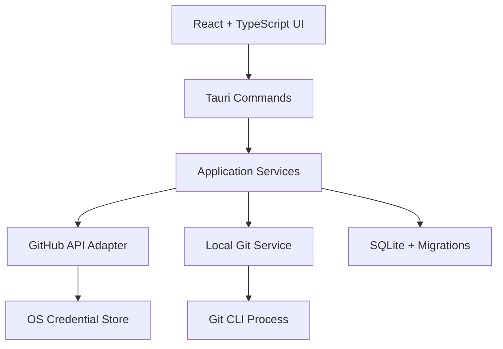

> *Not: Bu belge projenin eski adı GitOrbit ile yazılmıştır; proje 2026-11 itibarıyla Gybe adıyla sürmektedir.*

# GitOrbit — Product Requirements Document ve Sistem Tasarımı

> **Belge türü:** Product Requirements Document (PRD) + Software Requirements Specification (SRS) + System Design  
> **Ürün adı:** GitOrbit (çalışma adı; kesin marka adı değildir)  
> **Belge sürümü:** 1.0  
> **Tarih:** 28 Ekim 2026  
> **Durum:** Başlangıç tasarımı — uygulama geliştirilirken karar kayıtlarıyla güncellenecek  
> **Lisans hedefi:** Ücretsiz ve açık kaynak; önerilen lisans MIT (bağımlılık ve dağıtım incelemesi sonrasında kesinleştirilecek)  
> **Platformlar:** Linux öncelikli geliştirme; Windows ve macOS desteği  
> **Hedef kullanıcı:** Bireysel yazılım geliştiricileri, açık kaynak katkıcıları ve birden fazla Git deposuyla çalışan mühendisler

---

## İçindekiler

1. [Yönetici özeti](#1-yönetici-özeti)
2. [Ürün vizyonu ve problem tanımı](#2-ürün-vizyonu-ve-problem-tanımı)
3. [Hedef kullanıcılar ve personelar](#3-hedef-kullanıcılar-ve-personelar)
4. [Ürün hedefleri ve başarı metrikleri](#4-ürün-hedefleri-ve-başarı-metrikleri)
5. [Kapsam ve sürüm planı](#5-kapsam-ve-sürüm-planı)
6. [Fonksiyonel gereksinimler](#6-fonksiyonel-gereksinimler)
7. [Use case'ler](#7-use-caseler)
8. [Kullanıcı akışları ve ekran tasarımı](#8-kullanıcı-akışları-ve-ekran-tasarımı)
9. [Sistem mimarisi](#9-sistem-mimarisi)
10. [Modül sınırları](#10-modül-sınırları)
11. [Teknoloji yığını](#11-teknoloji-yığını)
12. [Veri modeli ve veritabanı tasarımı](#12-veri-modeli-ve-veritabanı-tasarımı)
13. [Tauri command API sözleşmesi](#13-tauri-command-api-sözleşmesi)
14. [GitHub API entegrasyonu](#14-github-api-entegrasyonu)
15. [Yerel Git işlemleri](#15-yerel-git-işlemleri)
16. [Güvenlik ve gizlilik](#16-güvenlik-ve-gizlilik)
17. [Hata yönetimi ve gözlemlenebilirlik](#17-hata-yönetimi-ve-gözlemlenebilirlik)
18. [Test stratejisi ve kalite kapıları](#18-test-stratejisi-ve-kalite-kapıları)
19. [CI/CD, paketleme ve yayınlama](#19-cicd-paketleme-ve-yayınlama)
20. [Erişilebilirlik ve UX ilkeleri](#20-erişilebilirlik-ve-ux-ilkeleri)
21. [Performans ve ölçeklenebilirlik](#21-performans-ve-ölçeklenebilirlik)
22. [Sprint planı ve ilk sprint görevleri](#22-sprint-planı-ve-ilk-sprint-görevleri)
23. [Repo ve klasör yapısı](#23-repo-ve-klasör-yapısı)
24. [Riskler ve azaltma planları](#24-riskler-ve-azaltma-planları)
25. [Mimari karar kayıtları](#25-mimari-karar-kayıtları)
26. [Açık sorular ve karar bekleyen konular](#26-açık-sorular-ve-karar-bekleyen-konular)
27. [MVP kabul kriterleri](#27-mvp-kabul-kriterleri)
28. [Vibe-coding aracı için geliştirme talimatı](#28-vibe-coding-aracı-için-geliştirme-talimatı)
29. [Sözlük](#29-sözlük)

---

# 1. Yönetici özeti

GitOrbit, GitHub hesapları ile yerel Git geliştirme süreçlerini tek bir masaüstü uygulamasında birleştiren, ücretsiz ve açık kaynak bir **Developer Workspace** ürünüdür.

Kullanıcı GitHub hesaplarını bağlayabilir, erişebildiği repository'leri keşfedebilir, yerel repolarını yönetebilir, branch ve commit geçmişini inceleyebilir, değişiklikleri stage edebilir, commit oluşturabilir ve fetch/pull/push/merge gibi Git işlemlerini uygulama içinden yürütebilir. İlerleyen sürümlerde pull request, issue, çoklu repository workspace ve görsel commit grafiği desteği eklenir.

GitOrbit, GitHub web arayüzünün birebir kopyası ya da yalnızca repository verilerini gösteren bir dashboard değildir. Temel farkı, **uzak GitHub verisi ile bilgisayardaki gerçek Git çalışma durumunu birleştirmesi** ve çoklu hesap/çoklu repo yönetimini geliştirici odaklı bir arayüzde sunmasıdır.

### Ürün kararları

- Masaüstü çerçevesi: Tauri 2
- UI: React + TypeScript
- Stil: Tailwind CSS ve erişilebilir bileşenler
- Yerel entegrasyon: Rust komut katmanı ve Git CLI
- Uzak entegrasyon: GitHub REST API; gerektiğinde GraphQL
- Yerel veri: SQLite
- Kimlik bilgileri: işletim sisteminin güvenli credential store'u
- Geliştirme sırası: Linux, ardından Windows/macOS doğrulaması
- Dağıtım modeli: ücretsiz, açık kaynak
- İlk sürüm: yerel Git çekirdeği ve temel GitHub hesap/repository entegrasyonu
- Sunucu: MVP'de zorunlu backend yok

---

# 2. Ürün vizyonu ve problem tanımı

## 2.1. Vizyon

Geliştiricinin GitHub hesaplarını, yerel repolarını ve günlük Git iş akışını tek bir hızlı, güvenli ve anlaşılır masaüstü çalışma alanında yönetmesini sağlamak.

## 2.2. Problem

Geliştiriciler günlük işlerinde birden fazla araç arasında geçiş yapar:

- GitHub web arayüzünde repository, branch, commit, PR ve issue inceler.
- Terminalde yerel Git komutlarını çalıştırır.
- IDE içinde kod değişikliklerini ve diff'leri okur.
- Birden fazla GitHub hesabı veya organizasyon arasında geçiş yapar.
- Birden fazla yerel repository'nin durumunu ayrı ayrı kontrol eder.
- Hangi hesapla hangi Git kimliğinin kullanıldığını takip etmekte zorlanabilir.

Bu da bağlam değiştirme maliyeti, yanlış hesapla commit atma riski ve repo durumunu anlamak için harcanan zamanı artırır.

## 2.3. Ürün ilkeleri

1. **Local-first:** Yerel Git işlemleri, kullanıcının kendi makinesinde ve kendi Git kurulumuyla çalışır.
2. **GitHub ve Git ayrımı:** Uzak API durumu ile yerel Git durumu aynı şeymiş gibi gösterilmez.
3. **Güvenli varsayılanlar:** Yıkıcı işlemler açık onay, durum kontrolü ve anlaşılır uyarılar gerektirir.
4. **Şeffaflık:** İşlem sonucu, hata ve mümkün olduğunda ham olmayan güvenli Git çıktısı kullanıcıya gösterilir.
5. **Açık kaynak:** Mimari, katkı süreci, lisans ve güvenlik politikası görünür olur.
6. **Çok platformlu tasarım:** Platforma özel davranışlar soyutlanır; Linux'ta çalışıyor olması diğer platformlarda çalıştığı anlamına gelmez.
7. **Kademeli kapsam:** Her sürüm çalışan, test edilebilir bir ürün bırakır.
8. **Minimum ayrıcalık:** GitHub yetkileri ve Tauri izinleri ihtiyaçla sınırlı tutulur.

---

# 3. Hedef kullanıcılar ve personelar

## 3.1. Bireysel geliştirici

- Bir kişisel ve bir iş GitHub hesabı kullanır.
- Kendi repolarını ve aktif branch'lerini görmek ister.
- Commit ve push işlemlerini hızlı yapmak ister.

## 3.2. Backend/mikroservis geliştiricisi

- Birden fazla servis reposuyla çalışır.
- Branch'ler, commit'ler ve yerel değişiklikler arasında geçiş yapar.
- İlişkili repoları tek workspace altında toplamak ister.

## 3.3. Açık kaynak katkıcısı

- Upstream repo, fork ve local clone arasında çalışır.
- Commit geçmişi, branch karşılaştırması ve PR durumunu inceler.
- Yanlış remote veya branch üzerinde işlem yapmaktan kaçınmak ister.

## 3.4. Çoklu hesap kullanan geliştirici

- Kişisel ve kurumsal hesaplarını ayrı yönetmek ister.
- Hesap başına repository erişimini net görmek ister.
- Yerel Git `user.name`/`user.email` değerinin beklenen kimlikle uyumlu olup olmadığını kontrol etmek ister.

---

# 4. Ürün hedefleri ve başarı metrikleri

## 4.1. Ürün hedefleri

- GitHub hesaplarını ve repository'leri tek uygulamada yönetmek.
- Temel günlük Git iş akışlarını GUI üzerinden tamamlamak.
- Çoklu repo ve branch keşfini hızlandırmak.
- Yanlış repo/branch/kimlik üzerinde işlem yapma olasılığını azaltmak.
- Linux, Windows ve macOS üzerinde sürdürülebilir dağıtım altyapısı oluşturmak.

## 4.2. Başarı metrikleri

MVP için başlangıç hedefleri; gerçek kullanıcı verisi toplandıktan sonra revize edilir:

- Temel akışların (repo ekleme, status görüntüleme, stage, commit) test senaryolarında başarı oranı: %100.
- Test edilmiş Git işlemlerinde uygulamanın beklenmeyen şekilde çökmesi: 0 bilinen durum.
- Yeni kullanıcı, rehber olmadan yerel repo ekleyip durumunu görebilmeli.
- GitHub API hataları ve rate limit durumları anlaşılır şekilde gösterilmeli.
- Linux build ve temel testler CI'da geçmeli; Windows/macOS build'leri erkenden CI kapsamına alınmalı.
- Token'ların loglara veya düz metin SQLite alanlarına yazıldığı bilinen bir yol bulunmamalı.
- Kritik Git işlemlerinin kullanıcı onayı ve hata durumları için otomatik testler bulunmalı.

Analitik/telemetri varsayılan olarak kapalı olmalı. İleride telemetri eklenirse açık rıza, veri minimizasyonu ve belgelenmiş opt-in/opt-out seçenekleri gerekir.

---

# 5. Kapsam ve sürüm planı

Öncelik tanımları:

- **P0:** MVP için zorunlu.
- **P1:** İlk kararlı sürüm veya hemen sonrası.
- **P2:** İleri sürüm/araştırma.

## 5.1. P0 — MVP

- Tauri masaüstü uygulama iskeleti.
- Modern IDE tarzı navigasyon, tema ve ana ekran.
- Git sürümü ve çalışma ortamı kontrolü.
- Yerel repository ekleme ve listeleme.
- Git status, aktif branch ve staged/unstaged değişiklikler.
- Branch listeleme ve güvenli checkout.
- Commit geçmişi ve diff görüntüleme.
- Stage/unstage ve commit oluşturma.
- Fetch, pull ve push.
- Güvenli merge akışı; çatışmayı algılama ve raporlama.
- Git kimliği kontrolü.
- SQLite ile yerel ayar/repo/workspace metadata kalıcılığı.
- GitHub OAuth/hesap bağlantısı ve repository listeleme.
- Birden fazla GitHub hesabını birbirinden ayırma.
- Hata yönetimi, testler ve Linux paketleme.
- Windows/macOS için build ve platform doğrulama planı.

## 5.2. P1 — İlk kararlı sürüm sonrası

- Pull request listesi ve detayları.
- Issue listesi ve detayları.
- Branch compare ve görsel commit grafiği.
- Çoklu repository workspace.
- Merge conflict için üç yönlü veya eşdeğer görsel çözümleme deneyimi.
- Gelişmiş filtreler ve birleşik aktivite görünümü.
- Commit/PR bağlantılarını daha iyi gösterme.
- Daha gelişmiş credential ve hesap yönetimi.

## 5.3. P2 — İleri özellikler

- GitHub dışındaki sağlayıcılar (ör. GitLab) için sağlayıcı arayüzü.
- Özelleştirilebilir workspace panoları.
- İsteğe bağlı AI destekli commit/PR özetleri (yalnızca kullanıcı açıkça etkinleştirirse).
- Repo sağlık metrikleri ve aktivite analizi.
- Takım senkronizasyonu veya bulut özellikleri (gerekirse ayrı tehdit modeli ve sunucu tasarımıyla).

## 5.4. MVP dışında kalanlar

- Tam IDE veya kod editörü yazmak.
- Git motorunu sıfırdan geliştirmek.
- Zorunlu merkezi backend.
- Kullanıcının izni olmadan uzaktaki veya yerel verileri değiştiren otomasyonlar.
- Kullanıcı onayı olmadan otomatik merge, force push veya reset.
- İlk sürümde bütün Git sağlayıcılarını desteklemek.
- Açıkça izin alınmadan kaynak kodunu veya repository içeriğini üçüncü taraf AI servisine göndermek.

---

# 6. Fonksiyonel gereksinimler

## 6.1. Hesap yönetimi

**FR-ACC-01 — Hesap bağlama (P0):** Kullanıcı GitHub hesabını desteklenen OAuth akışıyla bağlayabilmelidir.

**FR-ACC-02 — Çoklu hesap (P0):** Birden fazla hesap kaydedilebilmeli; kullanıcı aktif hesabı seçebilmelidir.

**FR-ACC-03 — Hesap ayrımı (P0):** Repository listeleri ve yetkiler hesap/erişim bağlamıyla ilişkilendirilmelidir.

**FR-ACC-04 — Hesap kaldırma (P0):** Kullanıcı hesabı uygulamadan kaldırabilmeli; ilgili credential güvenli depolamadan temizlenmelidir.

**FR-ACC-05 — Token yenileme/hata (P0):** Yetki iptali veya token geçersizliği anlaşılır hata olarak ele alınmalıdır.

## 6.2. Repository yönetimi

**FR-REP-01:** Uzak repository listesi API pagination ile yüklenmelidir.

**FR-REP-02:** Kullanıcı repo adı, owner, visibility ve uygun metadata üzerinden arama/filtreleme yapabilmelidir.

**FR-REP-03:** Kullanıcı yerel bir Git klasörünü çalışma alanına ekleyebilmelidir.

**FR-REP-04:** Kullanıcı remote repository'yi hedef klasöre clone edebilmelidir.

**FR-REP-05:** Repo detay ekranı uzak metadata ile yerel Git durumunu ayrı bölümlerde göstermelidir.

**FR-REP-06:** Bir repository birden fazla hesap tarafından erişilebilir olabilir; veri modeli bunu desteklemelidir.

## 6.3. Yerel Git ve source control

**FR-GIT-01:** Git kurulumu ve sürümü kontrol edilmelidir.

**FR-GIT-02:** Bir klasörün Git repository olup olmadığı doğrulanmalıdır.

**FR-GIT-03:** Branch, HEAD, detached HEAD, staged, unstaged, untracked ve conflicted dosyalar gösterilmelidir.

**FR-GIT-04:** Kullanıcı dosyaları stage/unstage edebilmelidir.

**FR-GIT-05:** Kullanıcı staged değişikliklerden commit oluşturabilmelidir.

**FR-GIT-06:** Commit öncesinde yerel `user.name` ve `user.email` kontrol edilebilmelidir.

**FR-GIT-07:** Kullanıcı fetch, pull ve push işlemlerini başlatabilmelidir.

**FR-GIT-08:** Checkout/merge gibi işlemlerden önce çalışma ağacı kontrol edilmeli; riskli durumda işlem durdurulmalı veya açık karar istenmelidir.

**FR-GIT-09:** Merge conflict oluşursa çatışan dosyalar listelenmeli ve çalışma ağacı korunmalıdır.

**FR-GIT-10:** Force push, hard reset ve temizleme gibi yüksek riskli işlemler MVP'de varsayılan akışta bulunmamalıdır.

**FR-GIT-11:** İşlem çıktısı ve durum bilgisi kullanıcıya gösterilmelidir.

**FR-GIT-12:** Komut iptali ve uygulama kapanması sırasında süreçlerin durumu yönetilmelidir.

## 6.4. Commit ve diff

**FR-COM-01:** Commit geçmişi sayfalı/limitli biçimde görüntülenmelidir.

**FR-COM-02:** Commit SHA, yazar, tarih, mesaj ve değişen dosyalar gösterilmelidir.

**FR-COM-03:** Kullanıcı bir commit'in dosya diff'lerini açabilmelidir.

**FR-COM-04:** Büyük diff'ler arayüzü kilitlememeli; gerektiğinde parça parça yüklenmelidir.

**FR-COM-05:** Binary dosyalarda metin diff'i zorlanmamalı; dosyanın binary olduğu belirtilmelidir.

## 6.5. GitHub entegrasyonu

**FR-GH-01:** Uygulama uzak repository metadata'sını GitHub API üzerinden okuyabilmelidir.

**FR-GH-02:** Pagination, rate limit, timeout ve auth hataları yönetilmelidir.

**FR-GH-03:** Token'lar UI katmanına verilmemelidir.

**FR-GH-04:** İlerleyen sürümlerde PR/issue işlevleri aynı sağlayıcı katmanından erişilebilir olmalıdır.

## 6.6. Workspace ve ayarlar

**FR-WS-01:** Kullanıcı birden fazla yerel repository'yi bir workspace içinde gruplandırabilmelidir (P1).

**FR-WS-02:** Kullanıcı son açılan repo ve ekran tercihlerinin yeniden açılışta korunmasını sağlayabilmelidir.

**FR-SET-01:** Tema, görünüm, Git yürütülebilir yolu ve temel uygulama ayarları yönetilebilmelidir.

**FR-SET-02:** Hassas credential'lar uygulama ayarlarına veya loglara yazılmamalıdır.

---

# 7. Use case'ler

## UC-01 — GitHub hesabı bağlama

**Aktör:** Geliştirici  
**Ön koşullar:** İnternet erişimi; uygulama kurulmuş.  
**Ana akış:**
1. Kullanıcı Accounts ekranını açar.
2. “GitHub hesabı ekle” seçeneğine basar.
3. Uygulama güvenli OAuth akışını başlatır.
4. Kullanıcı GitHub tarafında giriş yapar ve izinleri onaylar.
5. Uygulama token/credential bilgisini güvenli depolamaya kaydeder.
6. Hesap kimliği ve görünen kullanıcı bilgileri uygulamada görünür.
**Alternatif akışlar:** Kullanıcı iptal eder; izin reddedilir; callback başarısız olur; credential store kullanılamaz. Bu durumlarda hesap yarım/aktifmiş gibi gösterilmez.
**Sonuç:** Hesap bağlanmıştır veya kullanıcıya toparlama adımları gösterilmiştir.

## UC-02 — Birden fazla hesap arasında geçiş

**Aktör:** Çoklu hesap kullanan geliştirici  
**Ana akış:**
1. Kullanıcı hesap seçiciyi açar.
2. İstediği hesabı seçer.
3. Repository görünümü o hesabın erişim bağlamına göre yenilenir.
4. Yerel Git `user.name`/`user.email` değerleri otomatik değiştirilmez.
5. Uygulama, seçilen hesap ile yerel commit kimliği arasında olası uyumsuzluk varsa uyarı gösterebilir.
**Kabul:** Hesap geçişi credential karışmasına veya global Git ayarının sessizce değişmesine neden olmaz.

## UC-03 — Repository keşfetme ve clone

**Aktör:** Geliştirici  
**Ana akış:**
1. Kullanıcı Repositories ekranına gider.
2. Hesap/organizasyon bağlamını seçer.
3. Repo arar veya filtreler.
4. Repository detayını açar.
5. Clone seçeneğini kullanır ve hedef klasörü belirler.
6. Uygulama clone işlemini başlatır, ilerlemeyi gösterir ve başarıda repo kaydını oluşturur.
**Alternatifler:** Hedef klasör doludur; izin yoktur; remote erişilemez; auth başarısız olur. Hata açıkça gösterilir ve mevcut dosyalar gelişigüzel silinmez.

## UC-04 — Yerel repository ekleme

**Aktör:** Geliştirici  
**Ana akış:**
1. Kullanıcı “Add local repository” seçer.
2. Klasör seçiciyle dizini seçer.
3. Uygulama Git repository doğrulaması yapar.
4. `git status` ve branch bilgisi okunur.
5. Repo SQLite'a kaydedilir.
6. Repository detay ekranı açılır.
**Alternatif:** Seçilen klasör Git repo değilse kayıt yapılmaz ve kullanıcıya doğru klasörü seçmesi önerilir.

## UC-05 — Değişiklikleri inceleme ve commit

**Aktör:** Geliştirici  
**Ön koşul:** Yerel repo açık.  
**Ana akış:**
1. Kullanıcı Changes ekranını açar.
2. Staged, unstaged, untracked ve conflicted dosyalar ayrı gösterilir.
3. Kullanıcı dosya diff'ini inceler.
4. İstenen dosyaları stage eder.
5. Commit mesajını yazar.
6. Uygulama yerel Git kimliğini kontrol eder.
7. Commit oluşturulur ve yeni durum yüklenir.
**Alternatif:** Stage alanı boşsa commit engellenir; commit hook başarısız olursa hata ve güvenli çıktı gösterilir; commit mesajı boşsa işlem durdurulur.

## UC-06 — Branch değiştirme

**Aktör:** Geliştirici  
**Ana akış:**
1. Kullanıcı Branches ekranını açar.
2. Hedef branch'i seçer.
3. Uygulama mevcut çalışma ağacını kontrol eder.
4. Kirli çalışma ağacı varsa risk açıkça açıklanır; kullanıcı değişiklikleri güvenceye almadan işlem devam ettirilmez.
5. Checkout yapılır ve status yenilenir.
**Kabul:** Kullanıcı değişiklikleri sessizce kaybetmez.

## UC-07 — Fetch, pull ve push

**Aktör:** Geliştirici  
**Ana akış:**
1. Kullanıcı Git işlemini seçer.
2. Uygulama repository ve remote durumunu doğrular.
3. İşlem başlatılır; kullanıcı ilerleme/durum bilgisi görür.
4. İşlem tamamlanır veya hata oluşur.
5. Git status ve ahead/behind durumu yenilenir.
**Alternatif:** Auth reddi, ağ kopması, non-fast-forward, merge conflict veya remote reddi uygun hata koduyla raporlanır.

## UC-08 — Merge conflict algılama

**Aktör:** Geliştirici  
**Ana akış:**
1. Kullanıcı bir branch'i merge etmeyi seçer.
2. Uygulama repo durumunu kontrol eder ve merge işlemini başlatır.
3. Çatışma oluşursa işlem başarıyla tamamlanmış gibi gösterilmez.
4. Çatışan dosyalar listelenir.
5. Kullanıcı çözüm için dosyaları açabilir; conflict editörü P1 kapsamındadır.
**Kabul:** Çatışma durumu, kullanıcı çözmeden temiz/başarılı olarak raporlanmaz.

## UC-09 — Commit geçmişini ve diff'i inceleme

**Aktör:** Geliştirici  
**Ana akış:**
1. Kullanıcı History ekranını açar.
2. Commit listesi limitli şekilde yüklenir.
3. Bir commit seçilir.
4. Commit metadata'sı ve değişen dosyalar gösterilir.
5. Dosya seçilerek diff açılır.
**Alternatif:** Commit bulunamazsa veya binary diff ise uygun mesaj gösterilir.

## UC-10 — Workspace oluşturma

**Aktör:** Mikroservis geliştiricisi  
**Sürüm:** P1  
**Ana akış:**
1. Kullanıcı Workspaces ekranında yeni workspace oluşturur.
2. İlişkili yerel repoları ekler.
3. Repo sırasını belirler.
4. Workspace kaydedilir.
5. Kullanıcı workspace'i yeniden açtığında repo listesi ve sıralama korunur.

## UC-11 — Hesap erişimini kaldırma

**Aktör:** Geliştirici  
**Ana akış:**
1. Kullanıcı hesap ayarlarını açar.
2. “Hesabı kaldır” seçer.
3. Uygulama sonuçları açıklar.
4. Onaydan sonra credential güvenli depolamadan kaldırılır.
5. Hesap kaydı silinir veya tutarlı biçimde devre dışı bırakılır.
6. Yerel repository'ler ve yerel Git geçmişi silinmez.

---

# 8. Kullanıcı akışları ve ekran tasarımı

## 8.1. Ana yerleşim

Modern IDE düzeni:

- **Sol Activity Bar:** Overview, Accounts, Repositories, Source Control, Workspaces, Pull Requests, Issues, Settings.
- **Sol Sidebar:** Seçilen bölümün ağaç/liste içeriği.
- **Üst başlık/komut alanı:** Aktif repo, branch, arama ve komut paleti.
- **Merkez editör alanı:** Repository, History, Diff veya Settings görünümü; sekmeli çalışma.
- **Alt panel:** Git işlemleri, çıktı, hata ayrıntıları ve işlem geçmişi.
- **Durum çubuğu:** Aktif branch, repo yolu, remote durumu ve işlem durumu.

## 8.2. Ekranlar

### Overview
- Son açılan repolar.
- Yerel değişiklik bulunan repolar.
- Repo/hesap kısayolları.
- Son Git işlemleri.
- Hata veya bağlantı uyarıları.

### Accounts
- Bağlı hesaplar.
- Hesap ekleme/kaldırma.
- Credential/izin durumu.
- Aktif hesap seçimi.

### Repositories
- Uzak repo listesi.
- Yerel repo listesi.
- Arama, filtreleme, sıralama.
- Clone ve local repo ekleme.

### Repository Detail
- Changes.
- History.
- Branches.
- Remotes.
- GitHub metadata.

### Source Control
- Staged / unstaged / untracked / conflicted grupları.
- Dosya diff'i.
- Commit mesajı.
- Stage/unstage ve commit eylemleri.

### Branches
- Yerel/uzak branch'ler.
- Aktif branch göstergesi.
- Checkout ve compare.
- Ahead/behind bilgisi.

### Settings
- Tema.
- Git executable tespiti/yolu.
- Credential/account yönetimi.
- Kısayollar.
- Uygulama ve gizlilik seçenekleri.

## 8.3. Ana kullanıcı akışı

1. İlk açılışta Git ve ortam kontrolü.
2. Kullanıcı yerel repo ekler veya GitHub hesabı bağlar.
3. Uzak repo listesi yüklenir.
4. Kullanıcı repo klonlar veya yerel klasörü seçer.
5. Repository ekranında branch ve Git status görüntülenir.
6. Kullanıcı diff inceler, dosya stage eder ve commit oluşturur.
7. Kullanıcı fetch/pull/push işlemi yürütür.
8. Uygulama sonucu gösterir ve durumu yeniler.

## 8.4. UX kuralları

- Git işlemi sürerken ilgili eylemler doğru biçimde disable edilir veya kuyruklanır.
- Uzun işlemler iptal edilebilir olmalıdır; iptal desteği olmayan işlemlerde bu açıkça belirtilir.
- Hata mesajları yalnızca “işlem başarısız” dememeli; sonraki adımı açıklamalıdır.
- Yıkıcı eylemler açık onay ister.
- Klavye navigasyonu ve ekran okuyucu etiketleri desteklenir.
- Büyük listeler sanallaştırılabilir ve sayfalı yüklenebilir.
- Token, credential ve özel remote bilgileri ekran/log çıktısında gereksiz yere gösterilmez.

---

# 9. Sistem mimarisi

## 9.1. Mimari yaklaşım

GitOrbit, **tek masaüstü uygulaması içinde modüler monolit** olarak geliştirilecektir. MVP'de mikroservis mimarisi veya zorunlu sunucu gereksiz karmaşıklık yaratır.

React UI, Tauri command katmanına istek gönderir. Rust uygulama servisleri GitHub istemcisi, yerel Git yürütücüsü, SQLite ve işletim sistemi credential store'u ile çalışır.



## 9.2. Katmanların sorumlulukları

### UI katmanı
- Ekranlar ve bileşenler.
- Kullanıcı girdileri.
- Loading/error/success durumları.
- Tauri command çağrıları.
- UI state ve önbellek yönetimi.
- Git veya GitHub protokol mantığını doğrudan uygulamaz.

### Tauri command katmanı
- UI ile Rust servisleri arasında izin verilen komut arayüzü.
- Girdi doğrulama.
- İstek/yanıt tipleri.
- Uygun hata dönüşümü.
- Tauri capability/izin sınırları.

### Application services
- İş akışları.
- Hesap/repo bağlamı.
- Git işleminden önce ön koşul kontrolleri.
- GitHub ve yerel Git kaynaklarının birleştirilmesi.
- İşlem yaşam döngüsü.

### GitHub adapter
- API istekleri.
- Pagination.
- Rate limit ve retry politikaları.
- HTTP hata eşlemesi.
- Credential store'dan gereken token'ı alma.
- Token'ı UI'ya vermeme.

### Local Git service
- Git sürümü ve repo doğrulaması.
- Argümanları ayrı geçerek Git CLI çalıştırma.
- Stdout/stderr ve exit code yönetimi.
- Timeout/iptal desteği.
- Status, branch, diff, commit ve remote işlemleri.

### Storage
- SQLite bağlantısı.
- Şema migration'ları.
- Repo, hesap metadata'sı, workspace ve tercihler.
- Token'ın kendisi burada tutulmaz.

### Credential service
- OS keychain/credential store entegrasyonu.
- Token ekleme/okuma/silme.
- Platform farklılıklarını soyutlama.
- Loglarda hassas veriyi maskeleme.

## 9.3. Uzak ve yerel durum ayrımı

GitHub API'den alınan bilgiler ile local Git durumları ayrı veri kaynaklarıdır.

| Bilgi | Birincil kaynak |
|---|---|
| Kullanıcının GitHub hesabı | GitHub API |
| Kullanıcının erişebildiği uzak repo'lar | GitHub API |
| Uzak PR ve issue | GitHub API |
| Yerel branch ve HEAD | Git CLI |
| Staged/unstaged/untracked dosyalar | Git CLI |
| Yerel commit geçmişi | Git CLI |
| Uzak commit metadata'sı | GitHub API veya fetch edilmiş local Git |
| Push/pull sonucu | Git CLI process sonucu |
| Yerel kullanıcı tercihleri | SQLite |

---

# 10. Modül sınırları

| Modül | Sorumluluk | Yapmaması gereken |
|---|---|---|
| `accounts` | Hesap bağlama, seçim ve kaldırma | Token'ı UI'ya açmak |
| `github` | GitHub API client ve veri dönüşümü | Yerel Git komutları çalıştırmak |
| `repositories` | Uzak/local repo metadata'sı | Bütün Git iş mantığını taşımak |
| `local_git` | Git CLI, status, branch, commit, remote | GitHub hesabını yönetmek |
| `source_control` | Stage/commit/checkout/merge iş akışları | UI detaylarına bağımlı olmak |
| `diff` | Diff verisini normalize etmek | Kullanıcı onayı olmadan dosya değiştirmek |
| `workspaces` | Repo grupları ve sıralama | Git geçmişini kopyalamak |
| `storage` | SQLite ve migration'lar | UI'ya SQL detaylarını sızdırmak |
| `credentials` | OS credential store | Token'ı düz metin loglamak |
| `platform` | Dosya seçici, platform açma ve OS entegrasyonu | İş kurallarını taşımak |
| `operations` | Uzun işlem durumu, iptal ve sonuçlar | Hassas çıktıları kontrolsüz saklamak |

Modüller ilk aşamada ayrı süreçler veya servisler değildir; aynı uygulama içinde sınırları net kod modülleridir.

---

# 11. Teknoloji yığını

| Katman | Teknoloji | Gerekçe |
|---|---|---|
| Desktop | Tauri 2 | Windows/macOS/Linux |
| Frontend | React + TypeScript | Modüler ve tip güvenli UI |
| Build tool | Vite | Hızlı frontend geliştirme |
| Styling | Tailwind CSS | Tasarım sistemi ve hızlı iterasyon |
| UI components | shadcn/ui veya benzer erişilebilir bileşenler | Tutarlı arayüz |
| Native/backend katmanı | Rust | Tauri command'leri, güvenli process ve platform erişimi |
| Version control | Git CLI | Gerçek yerel Git davranışıyla uyum |
| Remote API | GitHub REST API; gerektiğinde GraphQL | Hesap ve uzak repo verisi |
| Database | SQLite | Yerel metadata ve tercihler |
| Credential storage | OS keychain/credential store | Token güvenliği |
| Frontend tests | Vitest + React Testing Library | UI ve fonksiyon testleri |
| Rust tests | Cargo test | Servis ve yardımcı fonksiyon testleri |
| E2E | Playwright veya uygun Tauri E2E yaklaşımı | Kritik kullanıcı akışları |
| CI | GitHub Actions | Test ve platform build'leri |

### Spring Boot kararı

MVP'de Spring Boot backend kullanılmayacaktır. Uygulamanın temel işlevleri doğrudan masaüstü uygulamasından gerçekleştirilebilir. İleride ekip senkronizasyonu, merkezi politikalar veya sunucu tabanlı otomasyon gerekirse ayrı bir servis değerlendirilir.

### Bağımlılık politikası

- Bağımlılıklar güncel sürümleri ve lisansları kontrol edilerek seçilir.
- Sürümler lockfile ile sabitlenir.
- Gereksiz büyük UI kütüphaneleri eklenmez.
- Git CLI sistemde mevcut olmalı; uygulama ilk açılışta tespit eder ve yoksa kurulum rehberi sunar.
- Git binary'sini uygulamayla birlikte dağıtma kararı platform ve lisans incelemesinden sonra verilir.

---

# 12. Veri modeli ve veritabanı tasarımı

## 12.1. Temel tablolar

### `accounts`
- `id` — uygulama içi UUID
- `provider` — başlangıçta `github`
- `provider_user_id` — GitHub kullanıcı ID'si
- `login`
- `display_name`
- `avatar_url`
- `credential_key` — OS credential store'daki kayda referans
- `created_at`
- `last_used_at`

Unique constraint: `(provider, provider_user_id)`.

### `repositories`
- `id`
- `provider_repo_id` — uzak sağlayıcı repository ID'si
- `owner_login`
- `name`
- `full_name`
- `remote_url`
- `default_branch`
- `visibility`
- `last_synced_at`
- `created_at`

Uzak repo ID'si varsa sağlayıcı kapsamında benzersiz olmalıdır. Aynı repo birden fazla hesap tarafından erişilebilir olabilir.

### `account_repositories`
- `account_id`
- `repository_id`
- Birleşik primary key: `(account_id, repository_id)`

### `local_repositories`
- `id`
- `repository_id` — eşleşen uzak repo varsa nullable foreign key
- `canonical_path` — benzersiz yerel yol
- `current_branch` — son bilinen metadata; gerçek değer gerektiğinde Git'ten okunur
- `last_opened_at`
- `created_at`

Bir uzak repo birden fazla farklı yerel klasöre klonlanabilir. Bu yüzden `repository_id` tek başına unique olmamalıdır.

### `workspaces`
- `id`
- `name`
- `created_at`
- `updated_at`

### `workspace_repositories`
- `workspace_id`
- `local_repository_id`
- `sort_order`
- Birleşik primary key: `(workspace_id, local_repository_id)`

### `app_preferences`
- `key`
- `value_json`

### İleride eklenebilecek tablolar
- `operation_history` — hassas olmayan işlem özeti.
- `cache_entries` — gerekiyorsa TTL ve kaynak metadata'sıyla.
- `repository_favorites` — ayrı bir ilişki tablosu veya repo metadata'sı.

## 12.2. Örnek SQLite şeması

```sql
CREATE TABLE accounts (
    id TEXT PRIMARY KEY,
    provider TEXT NOT NULL DEFAULT 'github',
    provider_user_id TEXT NOT NULL,
    login TEXT NOT NULL,
    display_name TEXT,
    avatar_url TEXT,
    credential_key TEXT,
    created_at TEXT NOT NULL,
    last_used_at TEXT,
    UNIQUE(provider, provider_user_id)
);

CREATE TABLE repositories (
    id TEXT PRIMARY KEY,
    provider_repo_id TEXT,
    owner_login TEXT,
    name TEXT NOT NULL,
    full_name TEXT,
    remote_url TEXT,
    default_branch TEXT,
    visibility TEXT,
    last_synced_at TEXT,
    created_at TEXT NOT NULL
);

CREATE TABLE account_repositories (
    account_id TEXT NOT NULL REFERENCES accounts(id) ON DELETE CASCADE,
    repository_id TEXT NOT NULL REFERENCES repositories(id) ON DELETE CASCADE,
    PRIMARY KEY (account_id, repository_id)
);

CREATE TABLE local_repositories (
    id TEXT PRIMARY KEY,
    repository_id TEXT REFERENCES repositories(id) ON DELETE SET NULL,
    canonical_path TEXT NOT NULL UNIQUE,
    current_branch TEXT,
    last_opened_at TEXT,
    created_at TEXT NOT NULL
);

CREATE TABLE workspaces (
    id TEXT PRIMARY KEY,
    name TEXT NOT NULL,
    created_at TEXT NOT NULL,
    updated_at TEXT NOT NULL
);

CREATE TABLE workspace_repositories (
    workspace_id TEXT NOT NULL REFERENCES workspaces(id) ON DELETE CASCADE,
    local_repository_id TEXT NOT NULL REFERENCES local_repositories(id) ON DELETE CASCADE,
    sort_order INTEGER NOT NULL DEFAULT 0,
    PRIMARY KEY (workspace_id, local_repository_id)
);

CREATE TABLE app_preferences (
    key TEXT PRIMARY KEY,
    value_json TEXT NOT NULL
);
```

Bu şema başlangıç taslağıdır. Migration dosyalarıyla yönetilir; uygulama güncellemesi kullanıcının verisini kaybettirmemelidir. SQLite foreign key enforcement bağlantı kurulurken etkinleştirilmelidir.

## 12.3. Veri tutarlılığı kuralları

- Yerel Git durumu kalıcı cache'den doğru kabul edilmez; gerektiğinde Git CLI'dan tekrar okunur.
- Uzak API verisinin son senkronizasyon zamanı tutulur.
- Hesap silinince yerel repo klasörleri ve commit geçmişi silinmez.
- Repo yolu değişmiş veya klasör silinmişse uygulama bunu algılayıp kullanıcıya yeniden bağlama seçeneği sunar.
- Token hiçbir tabloda düz metin olarak tutulmaz.
- Tarihler ISO 8601 biçiminde UTC olarak saklanır; UI yerel saat diliminde gösterir.

---

# 13. Tauri command API sözleşmesi

Bu uygulama klasik bir HTTP backend kullanmaz. React UI, Tauri'nin tanımlı command API'si aracılığıyla Rust katmanını çağırır. GitHub API, ayrı uzak entegrasyondur.

## 13.1. Command isimlendirme

### App/platform
- `get_app_info`
- `get_git_environment`
- `open_path_in_file_manager`
- `select_directory`

### Accounts
- `connect_github_account`
- `list_github_accounts`
- `set_active_github_account`
- `remove_github_account`

### Repositories
- `list_remote_repositories`
- `list_local_repositories`
- `add_local_repository`
- `clone_repository`
- `get_repository_details`

### Source control
- `get_git_status`
- `list_branches`
- `checkout_branch`
- `stage_files`
- `unstage_files`
- `create_commit`
- `fetch_repository`
- `pull_repository`
- `push_repository`
- `merge_branch`

### History/diff
- `get_commit_history`
- `get_commit_details`
- `get_commit_diff`
- `compare_branches`

### Workspace
- `list_workspaces`
- `create_workspace`
- `update_workspace`
- `add_repository_to_workspace`
- `remove_repository_from_workspace`

### Pull requests/issues (P1)
- `list_pull_requests`
- `get_pull_request_details`
- `list_issues`
- `get_issue_details`

## 13.2. Ortak yanıt tipi

Rust tarafında serileştirilebilir, TypeScript tarafında eşleşen tipler kullanılmalıdır.

```ts
type OperationResult<T> =
  | { ok: true; data: T }
  | {
      ok: false;
      error: {
        code: string;
        message: string;
        recoverable: boolean;
      };
    };
```

Tauri komutları bu modeli tutarlı kullanabilir veya Tauri'nin native error dönüşümüyle eşdeğer, belgelenmiş bir yaklaşım seçilebilir. Önemli olan UI'nın hata yapısını tahmin etmek zorunda kalmamasıdır.

## 13.3. Temel tipler

```ts
type ChangedFileStatus =
  | "added"
  | "modified"
  | "deleted"
  | "renamed"
  | "untracked"
  | "conflicted";

interface ChangedFile {
  path: string;
  status: ChangedFileStatus;
  staged: boolean;
}

interface GitStatus {
  repositoryPath: string;
  branch: string | null;
  isDetachedHead: boolean;
  stagedFiles: ChangedFile[];
  unstagedFiles: ChangedFile[];
  untrackedFiles: ChangedFile[];
  conflictedFiles: string[];
  ahead: number;
  behind: number;
}

interface CommitSummary {
  sha: string;
  shortSha: string;
  message: string;
  authorName: string;
  authorEmail?: string;
  authoredAt: string;
}

interface BranchSummary {
  name: string;
  isCurrent: boolean;
  isRemote: boolean;
  upstream?: string;
  ahead: number;
  behind: number;
}
```

Bunlar örnek sözleşmelerdir; gerçek Git durumunun tüm edge case'lerini karşılamak için implementasyon sırasında gözden geçirilecektir.

## 13.4. Hata kodları

| Kod | Anlam | Beklenen UI davranışı |
|---|---|---|
| `GIT_NOT_INSTALLED` | Git bulunamadı | Kurulum rehberi göster |
| `NOT_A_GIT_REPOSITORY` | Klasör Git repo değil | Başka klasör seçtir |
| `REPO_NOT_FOUND` | Repo yolu bulunamadı | Repo yolunu yeniden seçtir |
| `WORKTREE_DIRTY` | Riskli işlem öncesi yerel değişiklik var | Değişiklikleri göster, güvenli seçenek sun |
| `AUTH_REQUIRED` | GitHub kimlik doğrulaması gerekli | Hesabı yeniden bağlama akışını aç |
| `RATE_LIMITED` | API limiti aşıldı | Uygun süre bekle ve kontrollü yeniden dene |
| `REMOTE_REJECTED` | Remote işlemi reddetti | Güvenli hata ayrıntısı göster |
| `MERGE_CONFLICT` | Merge çatışması | Çatışan dosyaları listele |
| `OPERATION_CANCELLED` | Kullanıcı iptal etti | Normal iptal durumu göster |
| `PERMISSION_DENIED` | Dosya/işletim sistemi erişimi yok | İzin veya yol rehberi göster |
| `IO_ERROR` | Dosya sistemi hatası | Güvenli hata ve toparlama adımı göster |

---

# 14. GitHub API entegrasyonu

## 14.1. Sorumluluklar

GitHub adapter:
- HTTP isteklerini yürütür.
- OAuth akışını koordine eder veya auth modülüyle birlikte çalışır.
- Pagination uygular.
- Rate limit başlıklarını değerlendirir.
- Timeout ve ağ hatalarını yönetir.
- API yanıtlarını uygulama içi modellere dönüştürür.
- Credential store'dan token'ı yalnızca gerektiğinde okur.
- Token veya hassas header'ları loglamaz.

## 14.2. API yaklaşımı

- REST API, MVP'nin varsayılan seçimidir.
- GraphQL yalnızca belirgin biçimde daha verimli veya uygun olduğu durumlarda eklenir.
- API sürümleme başlıkları ve endpoint gereksinimleri uygulama sırasında resmi GitHub belgelerinden doğrulanır.
- Sayfalı veriler tek bir yanıtmış gibi varsayılmaz.
- Rate limit'e ulaşıldığında gereksiz retry döngüsü yapılmaz.
- Mümkünse conditional request/ETag ve cache kullanılır.

## 14.3. OAuth güvenlik notları

OAuth App ile GitHub App arasında seçim, masaüstü uygulamasının yetki kapsamı ve organizasyon erişimi gereksinimleri doğrulandıktan sonra kesinleştirilmelidir.

Masaüstü uygulamasında:
- OAuth callback akışı güvenli tasarlanmalı.
- Uygun olduğunda PKCE kullanılmalı.
- Client secret gibi gizli sunucu sırları masaüstü uygulamasına gömülmemeli.
- Token OS credential store'da saklanmalı.
- Token'ın kendisi React state'ine, loglara veya hata raporlarına aktarılmamalı.
- Kullanıcıya istenen izinler açıkça gösterilmeli.
- Yetki kaldırıldığında uygulama uygun yeniden kimlik doğrulama akışını sunmalı.

Bu bölüm, kodlamaya başlamadan önce resmi GitHub OAuth/GitHub App ve Tauri güvenlik dokümantasyonuyla doğrulanmalıdır.

---

# 15. Yerel Git işlemleri

## 15.1. Git CLI kullanımı

GitOrbit, Git motorunu sıfırdan uygulamaz. Yerel Git kurulumunu kullanır.

Kurallar:
- Git executable uygulama başlangıcında tespit edilir.
- Komut argümanları shell string birleştirme ile değil, process argüman listesiyle aktarılır.
- Çalışma dizini doğrulanır.
- Stdout, stderr ve exit code ayrı ele alınır.
- Uzun işlemlerde timeout/iptal yaklaşımı tanımlanır.
- Hassas remote URL veya credential içeren çıktı loglarda maskelenir.
- Repo içinde çalıştırılan hook'ların kullanıcı kodu çalıştırabileceği dikkate alınır.

## 15.2. Status

Status modeli şu durumları ayırt etmelidir:
- Staged.
- Unstaged.
- Untracked.
- Deleted/renamed.
- Conflicted.
- Detached HEAD.
- Upstream branch var/yok.
- Ahead/behind bilgisi (upstream varsa).

Ahead/behind bilgisi, güncel remote bilgisi yoksa eski veya kesin olmayan veri olabilir. UI bu durumun kaynağını ve son fetch zamanını gerektiğinde belirtmelidir.

## 15.3. Checkout

- Hedef branch doğrulanır.
- Kirli çalışma ağacı kontrol edilir.
- Yerel değişikliklerin üzerine yazılma riski varsa işlem sessizce devam etmez.
- Kullanıcı değişiklikleri commit/stash etme veya iptal seçeneklerinden uygun olanı seçebilir.
- Uygulama kendi kendine otomatik stash yapmaz; böyle bir özellik eklenirse geri alma akışı tasarlanır.

## 15.4. Commit

- Boş commit mesajı engellenir.
- Staged değişiklik yoksa işlem engellenir.
- `user.name` ve `user.email` effective Git config üzerinden kontrol edilir.
- Seçili GitHub hesabıyla e-posta eşleşmesi kesin olarak doğrulanamıyorsa “uyumsuzluk olabilir” biçiminde uyarı gösterilir; yanlış pozitifler nedeniyle commit sessizce engellenmez.
- Commit hook hataları gösterilir.
- Başarılı işlem sonrası status/history yenilenir.

## 15.5. Fetch, pull ve push

- Remote tanımlı mı kontrol edilir.
- İşlem sırasında durum/çıktı gösterilir.
- Non-fast-forward ve authentication hataları ayırt edilir.
- Pull sırasında conflict oluşursa sonuç conflict olarak raporlanır.
- Force push MVP'de standart akışa eklenmez.
- İşlem sonrası branch, upstream ve status tekrar okunur.

## 15.6. Merge

- Kaynak branch ve aktif hedef branch net gösterilir.
- Merge öncesinde status kontrol edilir.
- Conflict oluşursa başarısızlık/çözüm bekleyen durum olarak raporlanır.
- Conflict editörü P1 kapsamındadır; MVP çatışmayı tespit edip Git'in oluşturduğu durumu korumalıdır.
- Otomatik commit davranışı açıkça tanımlanır; kullanıcıya sürpriz yaratmamalıdır.

---

# 16. Güvenlik ve gizlilik

GitOrbit yerel kaynak koduna ve GitHub erişim token'larına dokunduğu için güvenlik birinci sınıf gereksinimdir.

## 16.1. Credential yönetimi

- Token'lar OS keychain/credential store'da saklanır.
- SQLite yalnızca credential referansı/anahtarı tutar.
- Token'lar loglanmaz, crash raporlarına eklenmez veya UI'ya gönderilmez.
- Hesap kaldırma akışı credential temizliğini içerir.
- Credential store kullanılamıyorsa uygulama token'ı güvensiz düz metin dosyaya düşürmez; kullanıcıya açık hata verir.

## 16.2. Tauri güvenlik sınırları

- Tauri capability'leri minimum gerekli izinlerle tanımlanır.
- UI her türlü shell komutunu çalıştırabilecek genel bir komut API'sine sahip olmaz.
- Git işlemleri belirli, tipli command'ler üzerinden gerçekleştirilir.
- Dosya sistemi erişimi ihtiyaçla sınırlandırılır.
- Üçüncü taraf UI içeriği veya uzaktan yüklenen web sayfaları uygulama içi ayrıcalıklı bağlamda çalıştırılmaz.
- CSP ve diğer Tauri güvenlik ayarları resmi dokümantasyon doğrultusunda yapılandırılır.

## 16.3. Git komut güvenliği

- Shell injection engellenir.
- Kullanıcı girdileri doğrudan shell script'e eklenmez.
- Repo path doğrulanır.
- Destructive işlemler için onay ve durum kontrolleri yapılır.
- `reset --hard`, `clean -fd`, force push gibi yüksek riskli işlemler MVP'de varsayılan akışta yer almaz.
- Git hook'larının yerel kod çalıştırabileceği kabul edilir.

## 16.4. Gizlilik

- Merkezi sunucuya zorunlu veri gönderimi yoktur.
- Kullanıcı repo içeriği uygulama tarafından üçüncü taraf servislere gönderilmez; GitHub'a yapılan normal API işlemleri bu kapsamın dışındadır.
- Telemetri varsa varsayılan olarak kapalı ve opt-in olmalıdır.
- Loglar hassas path/remote/token bilgileri bakımından filtrelenir.
- Hata raporları kullanıcı tarafından incelenebilir ve hassas bilgi içermeyecek şekilde hazırlanır.

## 16.5. Tehdit modeli

| Tehdit | Azaltma |
|---|---|
| Token sızıntısı | OS credential store, log redaction |
| Shell injection | Argüman listesi, allowlist komut katmanı |
| Yanlış repo üzerinde işlem | Aktif repo/branch bilgisini görünür kılma ve onay |
| Kirli çalışma ağacında veri kaybı | Ön kontrol ve güvenli engelleme |
| Yetki fazlalığı | Minimum GitHub scope/permission |
| API rate limit/DoS benzeri tekrarlar | Backoff ve kontrollü retry |
| SQLite verisinin bozulması | Transaction, migration ve yedekleme/onarım stratejisi |
| Tauri izinlerinin aşırı genişliği | Minimum capability ve güvenlik incelemesi |
| Hassas log/crash verisi | Redaction ve veri minimizasyonu |

---

# 17. Hata yönetimi ve gözlemlenebilirlik

## 17.1. Hata sınıfları

- Kullanıcı hatası: geçersiz yol, yanlış branch, boş commit mesajı.
- Ortam hatası: Git bulunamaması, credential store kullanılamaması.
- Ağ/API hatası: timeout, rate limit, erişim reddi.
- Git işlem hatası: merge conflict, non-fast-forward, hook hatası.
- Kalıcı veri hatası: SQLite erişim/migration hatası.
- Uygulama hatası: beklenmeyen panic/exception.

## 17.2. Loglama

- Yapılandırılmış loglar kullanılabilir.
- Token, Authorization header, secret veya credential içeren URL'ler loglanmaz.
- Gereksiz kaynak kodu veya diff içeriği loglanmaz.
- Kullanıcıya sunulan hata ile geliştirici logu ayrılır.
- Debug log seviyesi kullanıcı ayarıyla etkinleştirilebilir; hassas veri yine maskelenir.

## 17.3. İşlem durumu

Uzun süren işlemler için ortak durum modeli:
- `pending`
- `running`
- `succeeded`
- `failed`
- `cancelled`

İşlem tamamlanmadan UI başarı göstermez. İşlem iptali gerçek process iptaline bağlanamıyorsa UI bunu dürüstçe belirtmelidir.

---

# 18. Test stratejisi ve kalite kapıları

## 18.1. Unit testler

- Status çıktısını normalize eden parser'lar.
- Branch/commit model dönüşümleri.
- Hata kodu eşlemesi.
- Git kimliği kontrolü.
- Repo path doğrulama.
- SQLite repository ve migration mantığı.
- GitHub pagination/rate-limit davranışları için mock testler.

## 18.2. Integration testler

Geçici test repository'leri oluşturularak:
- Repo doğrulama.
- Status okuma.
- Dosya stage/unstage.
- Commit oluşturma.
- Branch oluşturma/checkout.
- Fetch/pull/push için yerel bare remote senaryoları.
- Merge conflict algılama.
- Repo silinmiş veya erişilemez hale gelmiş senaryolar.

Testler kullanıcının gerçek repo'sunu değiştirmemeli; geçici dizinler ve kontrollü test verileri kullanmalıdır.

## 18.3. UI testleri

- Navigasyon ve temel ekran render'ı.
- Boş/loading/error durumları.
- Repo ekleme formu.
- Commit mesajı doğrulaması.
- Riskli işlem onayları.
- Hesap seçimi ve boş hesap durumu.
- Klavye ile erişilebilirlik.

## 18.4. E2E testler

MVP'de en az şu akışlar:
1. Uygulama açılır.
2. Test reposu eklenir.
3. Status görüntülenir.
4. Dosya stage edilir.
5. Commit oluşturulur.
6. History ekranında yeni commit görünür.

GitHub OAuth E2E testi, gerçek kullanıcı hesabına bağımlı olmamalı; mümkün olduğunca mock/staging stratejisiyle ele alınmalıdır.

## 18.5. CI kalite kapıları

Her PR için:
- Format kontrolü.
- Lint.
- TypeScript typecheck.
- Frontend testleri.
- Rust format/lint/test.
- Güvenlik ve dependency kontrolleri.
- Linux build.
- Mümkün olduğunca erken Windows/macOS build.

Test geçmeden ana dala merge yapılmamalıdır.

---

# 19. CI/CD, paketleme ve yayınlama

## 19.1. Geliştirme akışı

- `main`: kararlı, testleri geçen dal.
- Kısa ömürlü feature branch'ler.
- Pull request üzerinden review.
- Conventional Commits veya eşdeğer tutarlı commit formatı.
- SemVer sürümleme: `MAJOR.MINOR.PATCH`.

## 19.2. Platform stratejisi

### Linux
- İlk geliştirme ve manuel doğrulama platformu.
- Gereksinime göre AppImage, `.deb` veya başka uygun format.
- Temiz kurulum testi ve credential store davranışı doğrulaması.

### Windows
- Windows installer ve imzalama seçeneklerinin değerlendirilmesi.
- Dosya yolu, process ve credential store farklılıklarının test edilmesi.

### macOS
- Apple Silicon ve mümkünse Intel mimarisi gereksinimlerinin belirlenmesi.
- Signing/notarization süreci ve keychain entegrasyonu.
- İlgili build runner üzerinde test.

Tüm paket formatları ilk sürümde zorunlu değildir; desteklenen işletim sistemleri ve dağıtım formatları README'de açıkça belgelenmelidir.

## 19.3. Release checklist

- Sürüm numarası güncellendi.
- Migration testleri geçti.
- Güvenlik/dependency kontrolü yapıldı.
- Platform build'leri başarıyla tamamlandı.
- Release notes hazırlandı.
- Bilinen sorunlar yazıldı.
- Paketler ve checksum'lar yayımlandı.
- Kullanıcıya token/hesap geçişi ve veri migration etkileri bildirildi.

---

# 20. Erişilebilirlik ve UX ilkeleri

- Tüm temel eylemler klavyeyle erişilebilir olmalı.
- Focus göstergesi görünür olmalı.
- Renk tek başına durum belirtmemeli; ikon/metin de kullanılmalı.
- Metin kontrastı yeterli olmalı.
- Loading ve hata durumları ekran okuyuculara bildirilebilmeli.
- Kullanıcı işlemi geri alınamıyorsa bu açıkça belirtilmeli.
- Git komutlarının etkisi net olmalı: örneğin “Push to origin/main” gibi.
- Commit/branch ekranında aktif repo ve aktif branch her zaman görünür olmalı.
- Uzun listelerde arama, filtre ve boş durum rehberi bulunmalı.
- Tema tercihleri sistem ayarına uyum sağlayabilmeli.

---

# 21. Performans ve ölçeklenebilirlik

- Repository listeleri sayfalı yüklenir.
- Commit geçmişi sınırlı batch'lerle çekilir.
- Büyük dosya/diff işlemleri UI thread'ini bloklamaz.
- Git subprocess'leri UI ana thread'inde senkron biçimde çalıştırılmaz.
- Gereksiz tam repo taraması yapılmaz.
- GitHub verisi için TTL/ETag gibi uygun cache politikaları uygulanır.
- Cache doğruluk kaynağı değildir; özellikle yerel Git status'u gerektiğinde tekrar okunur.
- Büyük repo'larda diff/commit listesi performansı test edilir.
- SQLite işlemleri transaction kullanır ve UI'ya gereksiz yazma çağrıları yapılmaz.
- İptal edilebilir işlemler için ortak mekanizma geliştirilir.

---

# 22. Sprint planı ve ilk sprint görevleri

Süreler tek geliştiricinin düzenli çalıştığı varsayımıyla yaklaşık tahmindir; kesin taahhüt değildir.

## Sprint 1 — Foundation (önerilen 5 iş günü)

**Sprint hedefi:** Linux'ta çalışan, yerel repo ekleyip Git status gösterebilen test edilebilir uygulama iskeleti.

### Gün 1 — Repo ve geliştirme ortamı
- [ ] `git-orbit` GitHub repository'sini oluştur.
- [ ] Tauri 2 + React + TypeScript iskeletini kur.
- [ ] Rust, Node.js ve package manager sürümlerini sabitle.
- [ ] Linux'ta uygulamayı çalıştır.
- [ ] README, CONTRIBUTING ve lisans taslağı ekle.

### Gün 2 — UI iskeleti
- [ ] Modern IDE ana yerleşimini oluştur.
- [ ] Sol navigasyon ve üst komut/arama alanını ekle.
- [ ] Overview ve Repository ekranlarını oluştur.
- [ ] Tema altyapısını kur.
- [ ] Kısayollar için temel altyapıyı oluştur.

### Gün 3 — Rust ve Git entegrasyonu
- [ ] Tauri command katmanını oluştur.
- [ ] Git sürümü ve ortam kontrolünü ekle.
- [ ] Yerel repo doğrulamasını uygula.
- [ ] Git status ve aktif branch bilgisini oku.
- [ ] Ortak hata/result tiplerini tanımla.

### Gün 4 — SQLite ve testler
- [ ] İlk SQLite migration'ını ekle.
- [ ] Local repository kaydetme/listeleme işlemlerini yaz.
- [ ] Rust unit testlerini ekle.
- [ ] TypeScript lint/typecheck/test komutlarını kur.
- [ ] Geçersiz repo ve bulunamayan klasör testlerini yaz.

### Gün 5 — Entegrasyon ve CI
- [ ] UI'dan yerel repo ekleme akışını tamamla.
- [ ] Repository ekranında gerçek Git status göster.
- [ ] GitHub Actions lint/test akışını kur.
- [ ] Linux build al ve temiz kurulum testi yap.
- [ ] Sprint çıktısı ve bilinen sorunları belgele.

### Sprint 1 kabul kriterleri
1. Uygulama Linux'ta açılır.
2. Kullanıcı yerel klasör seçebilir.
3. Git repo doğrulaması yapılır.
4. Aktif branch ve değişiklik durumu gerçek Git verisinden gösterilir.
5. Repo kaydı uygulama yeniden açıldığında korunur.
6. Geçersiz klasör uygulamayı çökertmez.
7. Testler ve Linux build başarılıdır.

## Sprint 2 — Repository explorer ve hesap temeli
- GitHub OAuth teknik kararını doğrula.
- Credential store entegrasyonunu kur.
- Bir hesabı bağlama ve kaldırma.
- Repository listesi, pagination ve filtre.
- Birden fazla hesap için veri modeli ve hesap seçimi.
- API hata ve rate limit akışları.

## Sprint 3 — Branch, commit ve diff
- Branch listesi ve checkout.
- Commit history.
- Commit details.
- Dosya diff'i.
- Ahead/behind ve upstream bilgisi.
- Büyük diff performans testleri.

## Sprint 4 — Tam yerel Git akışları
- Stage/unstage.
- Commit oluşturma.
- Git kimliği kontrolü.
- Fetch/pull/push.
- Merge ve conflict algılama.
- Riskli işlem onayları.
- Yerel bare remote ile entegrasyon testleri.

## Sprint 5 — Sağlamlaştırma ve ilk dağıtım
- Güvenlik incelemesi.
- Migration ve veri kaybı testleri.
- Linux paketleme.
- Windows/macOS CI ve manuel doğrulama.
- Dokümantasyon ve katkı rehberi.
- İlk alpha/beta sürümü.

PR/issue yönetimi, çoklu repo workspace ve gelişmiş conflict editörü bu çekirdek akışlar güvenilir olduktan sonra eklenir.

---

# 23. Repo ve klasör yapısı

Önerilen başlangıç yapısı:

```text
git-orbit/
├── src/
│   ├── app/
│   ├── components/
│   ├── features/
│   │   ├── accounts/
│   │   ├── repositories/
│   │   ├── source-control/
│   │   ├── commits/
│   │   ├── branches/
│   │   ├── workspaces/
│   │   └── settings/
│   ├── hooks/
│   ├── lib/
│   ├── types/
│   └── styles/
├── src-tauri/
│   ├── src/
│   │   ├── commands/
│   │   ├── modules/
│   │   │   ├── accounts/
│   │   │   ├── github/
│   │   │   ├── local_git/
│   │   │   ├── credentials/
│   │   │   ├── storage/
│   │   │   ├── repositories/
│   │   │   └── workspaces/
│   │   └── lib.rs
│   ├── migrations/
│   ├── capabilities/
│   └── Cargo.toml
├── tests/
├── .github/
│   └── workflows/
├── README.md
├── CONTRIBUTING.md
├── SECURITY.md
├── LICENSE
└── package.json
```

Bu bir hedef yapıdır. İlk commit'te bütün klasörlerin boş yere oluşturulması gerekmez. Tauri'nin standart proje dosyaları korunmalı; modüller ihtiyaç doğdukça eklenmelidir.

---

# 24. Riskler ve azaltma planları

| Risk | Etki | Azaltma |
|---|---|---|
| Çok geniş MVP | Teslimin gecikmesi | P0/P1 ayrımı ve sprint kabul kriterleri |
| OAuth/credential karmaşıklığı | Hesap güvenliği riski | Resmi dokümantasyon, OS secure storage, en az yetki |
| Yerel değişiklik kaybı | Çok yüksek | Dirty worktree kontrolü, destructive action guard |
| Git platform farklılıkları | Windows/macOS hataları | Platform CI ve gerçek platform testleri |
| API rate limit | Repo listelerinin yüklenememesi | Pagination, ETag/cache, backoff |
| Büyük repo/diff yavaşlığı | Kötü kullanıcı deneyimi | Lazy loading, limitler, async process |
| Yanlış hesap/kimlik | Yanlış yazar bilgisi | Identity Guard, açık hesap ve branch göstergesi |
| UI ve Rust sözleşmesinin ayrışması | Runtime hataları | Paylaşılan tip yaklaşımı, integration tests |
| Lisans uyumsuzluğu | Yayın riski | Bağımlılık lisans taraması ve lisans incelemesi |
| Vibe-coding aracının kapsamı büyütmesi | Kırılgan kod | Sprint bazlı prompt, test kapısı ve küçük PR'lar |

---

# 25. Mimari karar kayıtları

## ADR-001 — Tauri 2 seçimi
**Durum:** Önerilen  
**Karar:** Masaüstü çerçevesi Tauri 2.  
**Neden:** Çok platformlu uygulama ve yerel işlemlere kontrollü erişim.  
**Bedel:** Rust bilgisi ve platform paketleme süreçleri gerekir.

## ADR-002 — React + TypeScript
**Durum:** Önerilen  
**Karar:** UI React ve TypeScript ile yazılır.  
**Neden:** Modüler ekranlar, tipli sözleşmeler ve geniş ekosistem.

## ADR-003 — Git CLI
**Durum:** Önerilen  
**Karar:** Git işlemleri sistemdeki Git CLI üzerinden yürütülür.  
**Neden:** Kullanıcının gerçek Git ortamıyla uyumluluk ve Git motorunu yeniden yazmama.  
**Bedel:** Git sürümü/işletim sistemi farklılıkları test edilmelidir.

## ADR-004 — MVP'de backend yok
**Durum:** Önerilen  
**Karar:** Zorunlu merkezi sunucu yok.  
**Neden:** Basit dağıtım, düşük maliyet ve local-first yaklaşım.

## ADR-005 — SQLite
**Durum:** Önerilen  
**Karar:** Yerel metadata SQLite'ta tutulur.  
**Neden:** Tek kullanıcı masaüstü uygulaması için yeterli, taşınabilir ve basit.

## ADR-006 — Credential store
**Durum:** Zorunlu güvenlik ilkesi  
**Karar:** Token'lar işletim sisteminin güvenli credential store'unda tutulur.  
**Neden:** Hassas credential'ların uygulama DB'sinde düz metin tutulmasını önlemek.

## ADR-007 — Modüler monolit
**Durum:** Önerilen  
**Karar:** Uygulama içinde modül sınırları; mikroservis yok.  
**Neden:** MVP'de dağıtık sistem karmaşıklığı gereksiz.

## ADR-008 — Linux-first, cross-platform CI
**Durum:** Kabul edilen ürün yönü  
**Karar:** İlk geliştirme Linux'ta, Windows/macOS doğrulaması erken CI aşamasında.  
**Neden:** Geliştirme ortamını verimli kullanırken platform desteğini son ana bırakmamak.

## ADR-009 — Açık kaynak ve ücretsiz
**Durum:** Kabul edilen ürün yönü  
**Karar:** Ürün ücretsiz ve açık kaynak yayımlanır. MIT lisansı önerilir; yayımdan önce lisanslar gözden geçirilir.

---

# 26. Açık sorular ve karar bekleyen konular

Bu kararlar kodlamadan önce veya ilgili modül geliştirilirken resmi dokümantasyon ve küçük prototiplerle doğrulanmalıdır:

1. GitHub OAuth App mi GitHub App mi? Masaüstü uygulaması, organizasyon erişimi ve izin modeliyle uyumlu seçenek seçilmeli.
2. Tauri 2 için hangi SQLite eklentisi/erişim katmanı kullanılacak?
3. Linux'ta hangi credential store arayüzleri hedeflenecek; masaüstü ortamı bulunmadığında davranış ne olacak?
4. İlk Linux dağıtım formatı AppImage, `.deb` veya birden fazla format mı?
5. Windows/macOS için hangi installer ve imzalama yaklaşımı kullanılacak?
6. GitHub repository metadata'sı için cache TTL ve invalidation politikası ne olacak?
7. Commit grafiği için hangi görselleştirme bileşeni kullanılacak?
8. İlk kararlı sürümde PR/issue görüntüleme şart mı, yoksa P1 olarak mı kalmalı?
9. `operation_history` tablosu gerekli mi; gerekli olursa hangi hassas olmayan alanları saklayacak?
10. Git binary'sini uygulamayla dağıtmak mı, sistemdeki Git'i kullanmak mı tercih edilecek? Başlangıç kararı sistemdeki Git'i kullanmaktır.

Her kararın sonucu, gerekçesi ve etkisi ilgili ADR veya bu dokümanın yeni sürümüne yazılmalıdır.

---

# 27. MVP kabul kriterleri

MVP tamamlandığında:

- [ ] Kullanıcı birden fazla GitHub hesabını bağlayabilir ve ayrı ayrı seçebilir.
- [ ] Repository listesi sayfalı yüklenir ve aranabilir.
- [ ] Yerel repo eklenebilir ve uygulama yeniden açıldığında kayıt korunur.
- [ ] Uzak repo yerel klasöre clone edilebilir.
- [ ] Aktif branch, detached HEAD ve çalışma ağacı durumları doğru gösterilir.
- [ ] Staged, unstaged, untracked ve conflicted dosyalar ayırt edilir.
- [ ] Kullanıcı stage/unstage ve commit işlemi yapabilir.
- [ ] Commit geçmişi ve diff incelenebilir.
- [ ] Fetch/pull/push işlemleri çalışır ve sonuçları gösterilir.
- [ ] Merge conflict doğru algılanır ve çalışma ağacı korunur.
- [ ] Commit öncesinde Git kimliği kontrolü yapılır.
- [ ] Token'lar düz metin DB'de veya loglarda bulunmaz.
- [ ] Kritik Git işlemleri için testler vardır.
- [ ] Linux build ve temel testler CI'da geçer.
- [ ] Windows/macOS build/test planı çalışır durumdadır veya destek durumu açıkça belgelenmiştir.
- [ ] README, kurulum, katkı ve güvenlik belgeleri hazırdır.

---

# 28. Vibe-coding aracı için geliştirme talimatı

Bu doküman, bir AI kodlama aracıyla geliştirme yaparken ana ürün sözleşmesi olarak kullanılabilir. Ancak bütün ürünü tek prompt ile üretmeye çalışma. Araca **bir seferde tek sprint veya tek dikey özellik** ver; her aşamada testleri çalıştırmasını ve değişiklikleri açıklamasını iste.

## 28.1. Başlangıç prompt'u

Aşağıdaki metni kodlama aracına verebilirsin:

> Bu repository'de GitOrbit adlı açık kaynak, ücretsiz, çok platformlu bir masaüstü Developer Workspace uygulaması geliştiriyoruz. Ana sistem tasarımı `GITORBIT_SYSTEM_DESIGN.md` dosyasında tanımlıdır. İlk olarak bu dosyayı tamamen oku ve mevcut repository yapısını incele. Hemen bütün ürünü yazmaya başlama.
>
> Teknoloji hedefi Tauri 2, React, TypeScript, Vite, Tailwind CSS, Rust, Git CLI ve SQLite'tır. İlk geliştirme platformu Linux; Windows/macOS desteği mimarinin başından itibaren dikkate alınacaktır.
>
> İlk görev yalnızca Sprint 1 Foundation kapsamıdır: çalışan uygulama iskeleti, modern IDE yerleşimi, Git ortam kontrolü, yerel repository doğrulama, gerçek Git status/branch bilgisi, SQLite migration ve temel testler.
>
> Sistem tasarımında tanımlanan güvenlik kurallarına uy: Git komutlarını shell string birleştirerek çalıştırma; argümanları ayrı geçir. Token'ları düz metin saklama veya loglama. Kullanıcı dosyalarını silme/değiştirme; destructive Git işlemleri ekleme. Tauri izinlerini minimumda tut.
>
> Önce uygulanacak planı, dosya değişikliklerini, kullanılacak bağımlılıkları ve riskleri özetle. Sonra küçük, test edilebilir adımlarla uygula. Her adımın sonunda lint, typecheck, test ve uygun build kontrollerini çalıştır. Bir test çalıştırılamıyorsa nedenini belirt; testin geçtiğini varsayma. Sistem tasarımındaki bir gereksinim uygulanamıyorsa sessizce kapsam dışı bırakma; önce gerekçeyi ve alternatifleri açıkla.
>
> Mevcut proje dosyalarını incelemeden üstüne yazma. Gereksiz soyutlama veya mikroservis ekleme. Gerçek Git işlemlerini mock verilerle gizleme; testlerde mock kullanılsa bile uygulamanın temel akışı gerçek Git CLI'ı kullanmalıdır. Sprint 1 kabul kriterleri tamamlanmadan OAuth, PR/issue yönetimi veya ileri özelliklere geçme.

## 28.2. Her sprint için çalışma döngüsü

1. İlgili gereksinimleri oku.
2. Küçük uygulama planı çıkar.
3. Etkilenecek dosyaları belirt.
4. Kodu uygula.
5. Test, lint ve typecheck çalıştır.
6. Güvenlik ve veri kaybı risklerini kontrol et.
7. Tamamlananlar, kalanlar ve bilinen sorunları raporla.
8. Sprint kabul kriterlerini doğrula.

## 28.3. AI aracının yapmaması gerekenler

- İzin almadan büyük teknoloji değişikliği yapmak.
- Ürün kapsamını kendiliğinden büyütmek.
- Token veya secret'ları source code'a yazmak.
- Git işlemlerini yalnızca demo/mock sonuçlarla çalışıyor gibi göstermek.
- Testleri çalıştırmadan başarılı ilan etmek.
- Mevcut dosyaları kontrol etmeden üzerine yazmak.
- Kullanıcı verisini silebilecek komutları onaysız çalıştırmak.
- Belirsiz bir gereksinimi sessizce tahmin ederek uygulamak.

---

# 29. Sözlük

- **Repository (repo):** Git geçmişi ve proje dosyalarını içeren depo.
- **Remote:** Uzak Git deposuna verilen isim/adres.
- **Branch:** Geliştirme hattı.
- **Commit:** Belirli bir dosya durumu değişikliğini Git geçmişine kaydeden nesne.
- **Diff:** İki dosya veya revizyon arasındaki fark.
- **Stage/index:** Bir sonraki commit'e alınacak değişikliklerin hazırlık alanı.
- **Working tree:** Diskteki çalışma dosyalarının mevcut durumu.
- **Fetch:** Uzak Git referanslarını ve nesnelerini indirir; çalışma ağacını doğrudan güncellemez.
- **Pull:** Uzak değişiklikleri indirir ve yapılandırmaya göre mevcut branch'e entegre eder.
- **Push:** Yerel commit'leri remote'a gönderir.
- **Merge conflict:** Git'in iki değişikliği otomatik birleştiremediği durum.
- **OAuth:** Uygulamanın kullanıcı adına sınırlı yetkiyle erişim kazanmasını sağlayan yetkilendirme mekanizması.
- **Credential store:** Token/secret gibi hassas bilgileri güvenli saklayan işletim sistemi altyapısı.
- **Tauri command:** UI ile Rust uygulama katmanı arasındaki kontrollü çağrı.
- **PR (Pull Request):** Değişikliklerin bir branch'ten diğerine alınması için inceleme ve birleştirme talebi.
- **CI/CD:** Sürekli entegrasyon, test, paketleme ve yayınlama süreçleri.
- **MVP:** İlk kullanıcı değerini sağlayan, kapsamı sınırlı ürün sürümü.
- **ADR:** Bir mimari kararın bağlamını, seçimini ve sonuçlarını belgeleyen kayıt.

---

## Belgenin kullanım notu

Bu belge kapsamlı bir başlangıç tasarımıdır; her teknoloji ve güvenlik kararı uygulamaya başlamadan önce ilgili resmi dokümantasyonla doğrulanmalıdır. Gereksinimler, gerçek prototip ve test sonuçlarına göre sürümlenerek güncellenmelidir.

**İlk uygulama hedefi:** Sprint 1'i tamamla; Linux üzerinde gerçek bir yerel Git reposunu ekleyip branch/status bilgilerini gösteren ve veriyi yeniden açılışta koruyan çalışan prototipi üret. Sonra Sprint 2'ye geç.
